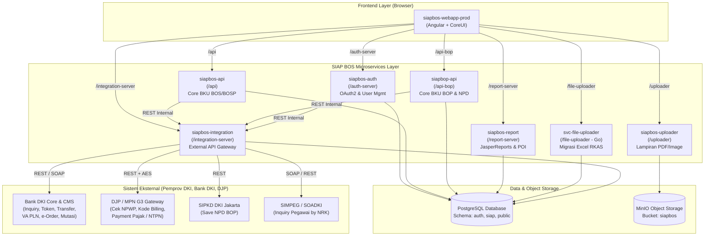
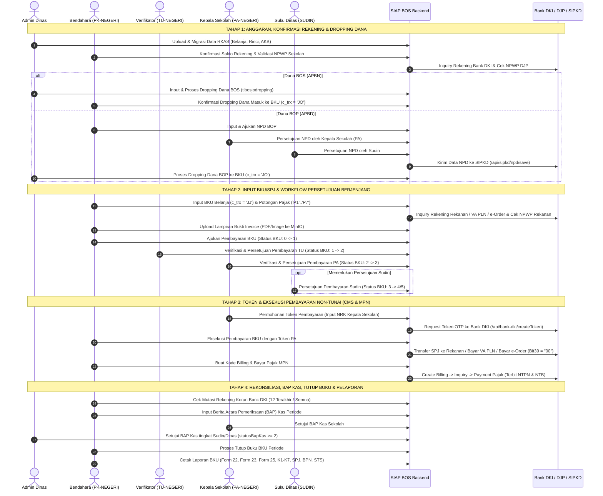

# Analisis Komprehensif Aplikasi SIAP BOS (SIAP BOSP & BOP)

Dokumen ini menyajikan hasil analisis mendalam terhadap source code proyek **SIAP BOS (Sistem Informasi Akuntabilitas Pendidikan - Bantuan Operasional Sekolah / Pendidikan)** yang berada pada direktori `D:\project_kerja_tdi\siap-bos`. Analisis mencakup deskripsi sistem, fungsi bisnis, arsitektur *microservices* backend, struktur database, alur bisnis *end-to-end*, integrasi pihak ketiga, arsitektur frontend, hingga daftar lengkap file laporan (*report*).

---

## 1. Apa Itu Aplikasi SIAP BOS & Fungsinya?

### 1.1 Definisi Aplikasi
**SIAP BOS** (yang pada antarmuka terbaru bertransformasi menjadi **SIAP BOSP & BOP**) adalah platform *Enterprise Financial Accountability & Cash Management System* milik **Dinas Pendidikan Provinsi DKI Jakarta** untuk mengelola, menatausahakan, mengeksekusi pembayaran non-tunai (*cashless*), memungut/menyetor pajak, dan mempertanggungjawabkan penggunaan dana operasional sekolah pada **Sekolah Negeri** (SD, SMP, SMA, SMK, SLB, PKBM, dan TK Negeri).

Aplikasi ini mengelola dua sumber dana utama:
1. **Dana BOS / BOSP (Bantuan Operasional Satuan Pendidikan)**: Bersumber dari **APBN (Kementerian Pendidikan, Kebudayaan, Riset, dan Teknologi)** yang disalurkan langsung ke rekening sekolah per tahap/periode.
2. **Dana BOP (Bantuan Operasional Pendidikan)**: Bersumber dari **APBD Provinsi DKI Jakarta** yang dicairkan melalui mekanisme **NPD (Nota Pencairan Dana)** yang terintegrasi dengan **SIPKD (Sistem Informasi Pengelolaan Keuangan Daerah)**.

### 1.2 Fungsi Utama Aplikasi
1. **Sinkronisasi & Konversi Anggaran (RKAS)**: Mengimpor dan memvalidasi pagu anggaran belanja sekolah dari sistem perencanaan **e-RKAS** ke dalam struktur Bagan Akun Standar (`trbas`) dan komponen kegiatan di SIAP BOS.
2. **Pencairan & Dropping Dana (Top-Up Kas Sekolah)**: Mencatat penyaluran dana masuk (*Dropping Dana*) ke Buku Kas Umum (BKU) sekolah, termasuk pengajuan & persetujuan **NPD** untuk dana BOP.
3. **Penatausahaan Buku Kas Umum (BKU) & SPJ**: Mencatat seluruh transaksi penerimaan dan pengeluaran sekolah (Belanja Barang/Jasa, Belanja Modal, Jasa Giro, Setoran Sisa Kas, serta Potongan/Setoran Pajak PPh 21, PPh 22, PPh 23, PPh Pasal 4 Ayat 2, PPh 26, PPh 15, dan PPN).
4. **Workflow Persetujuan Berjenjang (*Multi-Level Approval*)**: Menjamin akuntabilitas belanja melalui alur verifikasi bertingkat dari **Bendahara (PK)** $\rightarrow$ **Kasubag TU / Verifikator (TU)** $\rightarrow$ **Kepala Sekolah / Pengguna Anggaran (PA)** $\rightarrow$ **Suku Dinas Pendidikan (Sudin)** / **Dinas Pendidikan**.
5. **Eksekusi Pembayaran Non-Tunai (*Cashless CMS*)**: Terintegrasi langsung dengan **Core Banking / CMS Bank DKI** untuk validasi rekening rekanan, *generate* Token OTP Kepala Sekolah, transfer pembayaran langsung ke rekening rekanan (*Overbooking* Bank DKI maupun *SKN/BI-FAST* antarbank), serta pembayaran tagihan **Virtual Account PLN** dan **e-Order / Multi-Biller**.
6. **Manajemen & Pembayaran Pajak Otomatis (MPN G3 DJP)**: Terintegrasi dengan Direktorat Jenderal Pajak (via gateway Bank DKI) untuk validasi NPWP, pembuatan **Kode Billing** otomatis dari transaksi BKU, hingga pembayaran pajak secara elektronik yang menghasilkan **NTPN (Nomor Transaksi Penerimaan Negara)** dan **NTB**.
7. **Rekonsiliasi Bank, BAP Kas & Tutup Buku**: Menyediakan pengecekan mutasi rekening koran Bank DKI secara *real-time*, pembuatan **Berita Acara Pemeriksaan (BAP) Kas**, dan penguncian transaksi per periode (**Tutup Buku BKU**).
8. **Pelaporan Regulasi & Monitoring Eksekutif**: Menghasilkan puluhan dokumen laporan resmi berformat **PDF (JasperReports)** dan **Excel (Apache POI)** sesuai standar Kemendikbud dan Pemprov DKI Jakarta (Form 22, Form 23, Form 25, K1–K7, Kartu Kendali, SPJ, BPN, STS, dan Monitoring Serapan Dinas/Sudin).

---

## 2. Arsitektur Ekosistem Repositori (`D:\project_kerja_tdi\siap-bos`)

Berdasarkan analisis direktori `D:\project_kerja_tdi\siap-bos`, sistem dibangun menggunakan arsitektur **Microservices** yang terdiri dari **11 sub-folder/repositori**:

| No | Nama Folder / Service | Teknologi Utama | Port / Proxy Path | Tanggung Jawab Utama |
| :- | :--- | :--- | :--- | :--- |
| 1 | `siapbos-auth` | Java 8, Spring Boot 2.3, Spring Security OAuth2, JWT, Flyway | `:8080` (`/auth-server`) | Autentikasi OAuth2 (`/oauth/token`), manajemen pengguna, otoritas/role, menu, master periode, master sekolah, master pajak, dan integrasi cek pegawai SIMPEG. |
| 2 | `siapbos-api` | Java 8, Spring Boot 2.3, Spring Data JDBC/JPA, Flyway | `:9090` (`/api`) | Core bisnis **Dana BOS/BOSP Negeri**: Konfirmasi dana, Dropping dana BOS, Input BKU/SPJ, Pengajuan, Approval TU/PA/Sudin, Token, Pembayaran BKU & Pajak, Setoran STS, BAP Kas, Tutup Buku, dan Konversi RKAS. |
| 3 | `siapbop-api` | Java 8, Spring Boot 2.3, Spring Data JDBC/JPA | `:9099` (`/api-bop`) | Core bisnis **Dana BOP Negeri**: Seluruh alur BKU BOP ditambah modul **NPD (Nota Pencairan Dana)**, Persetujuan NPD PA & Sudin, serta modul **Koreksi BKU** (Kode Akun, Nilai Belanja, Batal Transfer SPJ). |
| 4 | `siapbos-integration` | Java 8, Spring Boot 2.3, RestTemplate, AES Crypto | `:8989` (`/integration-server`) | Gateway integrasi eksternal ke **Bank DKI** (Inquiry Rekening, Token, Transfer SPJ, VA PLN, e-Order, Mutasi Rekening), **Pajak DJP/MPN** (NPWP, e-Billing, Payment NTPN), **SIPKD** (Save NPD BOP), dan **SIMPEG** (Cek NRK). |
| 5 | `siapbos-report` | Java 8, Spring Boot 2.2, JasperReports 6.7, Apache POI | `:8085` (`/report-server`) | Engine pembuat laporan **PDF** (`.jrxml`/`.jasper`) dan **Excel** (`.xlsx`) untuk seluruh modul BOS, BOP, Sudin, dan Dinas. |
| 6 | `siapbos-uploader` | Java 8, Spring Boot, MinIO SDK | `:8090` (`/uploader`) | Layanan penyimpanan objek (*Object Storage* MinIO) untuk unggah, pratinjau (*preview*), dan unduh berkas PDF/Gambar (Invoice, Bukti SPJ, Berita Acara). |
| 7 | `svc-file-uploader` | Go (Golang 1.18), Fiber v2, GORM, Excelize | `:3000` (`/file-uploader`) | Microservice performa tinggi berbasis Go untuk mengunggah dan memigrasikan ribuan baris file Excel/CSV **RKAS** (`belanja`, `belanja_rinci`, `belanja_rinci_akb`). |
| 8 | `siapbos-webapp-prod` | Angular 10, CoreUI, Bootstrap 4, NgBootstrap, DataTables | `:4200` (Frontend Utama) | Aplikasi Web SPA (*Single Page Application*) versi produksi yang digunakan oleh seluruh aktor (Sekolah, Sudin, Admin Dinas). |
| 9 | `siapbos-webapp` | Angular 10 | `:4200` | Repositori pengembangan awal frontend SIAP BOS. |
| 10 | `siapbop-webapp` | Angular 10 | `:4200` | Repositori frontend khusus modul BOP sebelum digabungkan ke dalam `siapbos-webapp-prod`. |
| 11 | `devops` | Shell Script, Docker, GitLab CI, PM2 | - | Konfigurasi *deployment*, *reverse proxy*, dan *pipeline* CI/CD. |

### Diagram Arsitektur Sistem Eksisting

---

## 3. Aktor, Role (Otoritas), dan Hak Akses

Berdasarkan skema `auth.trsiapotoritas`, `auth.trsiappengguna`, dan `auth.trsiapaplikasi` pada `siapbos-auth`, berikut adalah pembagian otoritas pengguna di dalam SIAP BOS:

| Kode Otoritas (`c_otoritas`) | Nama Peran / Jabatan | Tingkat Unit Kerja | Tanggung Jawab & Hak Akses di Aplikasi |
| :--- | :--- | :--- | :--- |
| `ADMIN` / `ADMIN-DINAS` | Administrator Dinas Pendidikan | Provinsi DKI Jakarta | Mengelola User Management, Master Periode, Master Sekolah, Master Pajak, Konversi/Pengecekan RKAS, **Dropping Dana**, Batas Pengajuan, Approval BAP Kas Dinas, Batal Tutup BKU, dan Laporan Monitoring Dinas. |
| `SUDIN` | Suku Dinas Pendidikan (Wilayah) | Kota/Kabupaten Administrasi (JP, JU, JB, JS, JT, Kepulauan Seribu) | Menyetujui **NPD BOP Sudin**, menyetujui **Pembayaran BKU Sudin** (untuk nominal/kondisi tertentu), menyetujui **Setoran Sisa Kas / STS**, menyetujui **Koreksi BKU**, dan memantau Laporan Monitoring Sudin. |
| `PA-NEGERI` | Pengguna Anggaran (Kepala Sekolah) | Satuan Pendidikan (Sekolah Negeri) | Menyetujui pengajuan belanja dari TU (**Approval PA**), menyetujui **NPD BOP PA**, melakukan **Permohonan Token** Bank DKI (berdasarkan NRK Kepala Sekolah), mengeksekusi/menyetujui pembayaran, serta menyetujui **BAP Kas**. |
| `TU-NEGERI` | Verifikator Belanja (Kasubag Tata Usaha) | Satuan Pendidikan (Sekolah Negeri) | Memverifikasi kebenaran dokumen SPJ, invoice, pajak, dan rincian akun belanja yang diinput oleh Bendahara (**Approval Pembayaran TU**). |
| `PK-NEGERI` | Pemegang Kas (Bendahara Sekolah) | Satuan Pendidikan (Sekolah Negeri) | Melakukan **Konfirmasi Saldo Rekening**, **Konfirmasi Dropping Dana**, **Input NPD BOP**, **Input BKU & SPJ**, **Pengajuan Pembayaran BKU**, **Eksekusi Transfer BKU & Pajak**, **Input Setoran Sisa/Pendapatan Lain**, **Input BAP Kas**, **Tutup Buku**, dan **Cetak Laporan BKU**. |

### Daftar Modul Aplikasi (`auth.trsiapaplikasi`)
Setelah login, pengguna diarahkan ke **Landing Page (`/landing-page`)** yang menampilkan *card* modul sesuai otoritas pengguna:
1. **`BOS` (`bos-negeri`)**: Penatausahaan BKU BOS / BOSP Negeri.
2. **`BOP` (`bop-negeri`)**: Penatausahaan BKU BOP Negeri & NPD.
3. **`ADMN` (`administrator`)**: Menu Administrator Dinas (Dropping Dana, Konversi RKAS, Batas Pengajuan, Helpdesk).
4. **`UM` (`user-management`)**: Pengelolaan Pengguna, Otoritas, Aplikasi, Menu, Master Periode, Master Sekolah, dan Master Pajak.
5. **`LAIN` (`sekolah`)**: Konfirmasi Saldo Rekening & Validasi Rekening/NPWP Sekolah.

---

## 4. Analisis Alur Bisnis End-to-End (Business Workflow)

Alur bisnis SIAP BOS dirancang secara sekuensial dan terkontrol ketat mulai dari tahap persiapan anggaran hingga penutupan buku akhir bulan/periode.

### Penjelasan Detail Setiap Tahap Alur Bisnis

#### Tahap 1: Pra-Transaksi, Migrasi RKAS, dan Dropping Dana
1. **Pengaturan Periode & Batas Pengajuan**:
   - Admin Dinas membuka tahun anggaran (`trtahunangg`) dan periode penyaluran (`trperiode`: Tahap 1, Tahap 2, Tahap 3 atau Triwulan/Bulan) serta mengatur batas tanggal pengajuan belanja sekolah (`/administrator/batas-pengajuan`).
2. **Migrasi & Konversi RKAS**:
   - Data anggaran sekolah dari e-RKAS diunggah melalui `svc-file-uploader` ke tabel staging (`rkas.belanja`, `rkas.belanja_rinci`, `rkas.belanja_rinci_kom_akb`) lalu dikonversi ke skema SIAP BOS.
   - Menu **Pengecekan Data RKAS** (`/api/pengecekan-data-rkas`) memastikan pagu per kegiatan, kode akun (`trbas`), dan komponen sudah sinkron sebelum sekolah dapat bertransaksi.
3. **Konfirmasi Saldo Rekening Sekolah**:
   - Bendahara (`PK-NEGERI`) masuk ke modul **Sekolah (`/sekolah`)** untuk memvalidasi nomor rekening Bank DKI (BOS & BOP), nama rekening, saldo awal, dan NPWP Sekolah.
4. **Pencairan / Dropping Dana (`c_trx = 'JO'`)**:
   - **Alur BOS**: Admin Dinas mengunggah/memproses data dropping (`tibosjodropping`) melalui *stored procedure* `siap.dropping_dana_bos_proses`. Sekolah kemudian melakukan **Konfirmasi Dropping Dana** (`/api/konfirmasi-dana`) sehingga otomatis terbentuk baris transaksi penerimaan kas (`c_trx = 'JO'`) pada tabel `siap.tmbosbku` yang menambah saldo kas bank sekolah.
   - **Alur BOP (dengan NPD)**: Sekolah membuat **Pengajuan NPD (Nota Pencairan Dana)** berdasarkan rencana kebutuhan belanja bulan/tahap berjalan $\rightarrow$ disetujui oleh **PA (Kepala Sekolah)** $\rightarrow$ disetujui oleh **Sudin** $\rightarrow$ dikirim ke **SIPKD** (`/integration-server/api/sipkd/npd/save`) $\rightarrow$ dana cair (*dropping*) ke rekening BOP sekolah.

#### Tahap 2: Pencatatan BKU & SPJ (`Input BKU`)
Bendahara (`PK-NEGERI`) mencatat transaksi pada menu **Input BKU** (`/bos-negeri/input-bku` atau `/bop-negeri/input-bku`).
Sistem mengelompokkan transaksi berdasarkan kode `c_trx`:

| Kode `c_trx` | Jenis Transaksi BKU | Efek Saldo Kas | Keterangan |
| :---: | :--- | :---: | :--- |
| `JO` | Pengisian Kas / Dropping Dana | **(+) Masuk** | Pencairan dana BOS/BOP dari Kas Negara/Daerah ke rekening sekolah. |
| `JG` | Jasa Giro / Bunga Bank | **(+) Masuk** | Penerimaan jasa giro dari rekening Bank DKI. |
| `LL` | Pendapatan Lain-lain | **(+) Masuk** | Penerimaan pengembalian/koreksi atau pendapatan sah lainnya. |
| `JJ` | Pertanggungjawaban Belanja (SPJ) | **(-) Keluar** | Belanja barang/jasa/modal ke rekanan, VA PLN, atau e-Order. |
| `ST` | Setor Sisa Belanja / Pendapatan Lain | **(-) Keluar** | Penyetoran kembali sisa dana atau jasa giro ke Kas Daerah/Negara (STS). |
| `P1` | Pajak PPh Pasal 21 | **(+) Pungut / (-) Setor** | Pajak penghasilan atas honorarium/jasa orang pribadi. |
| `P2` | Pajak PPh Pasal 22 | **(+) Pungut / (-) Setor** | Pajak atas pembelian barang dengan nilai tertentu. |
| `P3` | Pajak PPh Pasal 23 | **(+) Pungut / (-) Setor** | Pajak atas jasa katering, sewa, pemeliharaan, atau jasa badan usaha. |
| `P4` | Pajak PPh Pasal 4 Ayat (2) | **(+) Pungut / (-) Setor** | Pajak final (sewa tanah/bangunan, jasa konstruksi, UMKM). |
| `P5` | Pajak PPN (Pajak Pertambahan Nilai) | **(+) Pungut / (-) Setor** | PPN atas belanja barang/jasa kena pajak. |
| `P6` | Pajak PPh Pasal 26 | **(+) Pungut / (-) Setor** | Pajak atas wajib pajak luar negeri. |
| `P7` | Pajak PPh Pasal 15 | **(+) Pungut / (-) Setor** | Pajak norma penghitungan khusus (pelayaran/penerbangan). |

Saat menginput transaksi belanja (`JJ`), Bendahara:
1. Memilih **Metode Pembayaran**: Transfer Reguler (Bank DKI / Bank Lain), **Virtual Account PLN**, atau **e-Order / Multi-Biller**.
2. Memilih **Kegiatan (SNP & Kegiatan)** dan merinci **Komponen / Kode Akun Belanja (`tmbosbkurinci`)** beserta volume, harga satuan, dan spesifikasi. Sistem memvalidasi agar nilai belanja tidak melebihi sisa pagu RKAS dan saldo kas sekolah.
3. Mengisi identitas **Rekanan** dan melakukan **Cek Rekening Bank** (via `siapbos-integration` ke Bank DKI) serta **Cek NPWP** (via DJP) untuk memastikan rekening dan NPWP aktif serta valid.
4. Mengisi **Potongan Pajak** (`P1` s/d `P7`). Sistem otomatis menghitung **Nilai Bruto**, **Total Pajak**, dan **Nilai Netto** yang akan ditransfer ke rekanan.
5. Mengunggah **File Bukti / Invoice (PDF)** ke layanan `siapbos-uploader` (MinIO).

#### Tahap 3: Pengajuan & Persetujuan Berjenjang (Workflow Status BKU)
Setiap transaksi belanja (`JJ`) memiliki siklus hidup status (`c_bku_status`) yang dikawal oleh beberapa *controller*:

| Nilai `c_bku_status` | Nama Status | Aktor Eksekutor | Endpoint Controller (`siapbos-api`) |
| :---: | :--- | :--- | :--- |
| `'0'` | **Draft / Belum Diajukan** | `PK-NEGERI` (Bendahara) | `InputSpjController` (`/api/input-spj`) |
| `'1'` | **Diajukan ke Verifikator (TU)** | `PK-NEGERI` (Bendahara) | `PengajuanBkuBosController` (`/api/pengajuan-bku-bos`) |
| `'2'` | **Disetujui TU / Diajukan ke PA** | `TU-NEGERI` (Kasubag TU) | `ApprovalPembayaranTuController` (`/api/approval-pembayaran-tu`) |
| `'3'` | **Disetujui PA (Siap Bayar)** | `PA-NEGERI` (Kepala Sekolah) | `ApprovalPembayaranPaController` (`/api/approval-pembayaran-pa`) |
| `'4'` / `'5'` | **Pengajuan / Persetujuan Sudin** | `SUDIN` (Suku Dinas) | `ApprovalPembayaranSudinController` (`/api/approval-pembayaran-sudin`) |
| `'9'` / *Reject* | **Ditolak / Dikembalikan** | `TU`, `PA`, atau `SUDIN` | Dikembalikan ke status sebelumnya disertai alasan penolakan (`e_alasan_batal`). |

#### Tahap 4: Permohonan Token & Eksekusi Pembayaran Non-Tunai
1. **Permohonan Token (`PermohonanTokenController`)**:
   - Kepala Sekolah (`PA-NEGERI`) masuk ke menu **Permohonan Token** (`/bos-negeri/permohonan-token`).
   - Sistem mengambil **6 digit NRK Kepala Sekolah** dan memanggil `/integration-server/api/bank-dki/createToken`.
   - Token disimpan pada field `c_token` dan waktu kedaluwarsa `d_token_expire` di tabel BKU.
2. **Pembayaran BKU / Transfer SPJ (`PembayaranBkuBosController`)**:
   - Pada menu **Pembayaran BKU** (`/bos-negeri/pembayaran-bku`), transaksi yang sudah berstatus disetujui PA dan memiliki Token aktif dieksekusi pembayarannya:
     - **Transfer Rekanan Sesama Bank DKI (*Overbooking*)** atau **Antarbank (*SKN / BI-FAST*)** melalui `/integration-server/api/spj-transfer/transfer`.
     - **Pembayaran Tagihan VA PLN / Multi-Biller / e-Order** melalui `/integration-server/api/bank-dki/biller-payment` atau `payment-overbook`.
   - Jika Bank DKI mengembalikan `bit39 = "00"` (Sukses), sistem mencatat nomor referensi jurnal bank (`i_jurnal_bank`, `c_trx_bank`, `d_transfer`, `c_transfer_status = '00'`) dan mengunci transaksi.
3. **Pembayaran Pajak MPN (`PembayaranPajakBkuBosController`)**:
   - Pada menu **Pembayaran Pajak BKU** (`/bos-negeri/pembayaran-pajak`), untuk setiap rincian pajak (`P1`–`P7`):
     1. **Create Billing**: Memanggil `/integration-server/api/spj-transfer-pajak/{idBkuPg}/create/byIdBkuPg` untuk menerbitkan **Kode Billing (`i_billing`)** dan masa kedaluwarsanya (`d_billing_expire`).
     2. **Inquiry Billing**: Mengecek tagihan pajak aktif di MPN G3.
     3. **Payment Pajak**: Mengeksekusi debet rekening sekolah untuk membayar Kode Billing, menghasilkan **NTPN (`i_ntpn`)**, **NTB (`i_ntb`)**, dan tanggal buku pajak (`d_buku_lunas`).

#### Tahap 5: Setoran Sisa Kas / STS & Koreksi BKU
1. **Setor Pendapatan Lain / Sisa Belanja (`InputSetorPendapatanLainController` & `CetakSetorController`)**:
   - Digunakan untuk menyetorkan kembali sisa dana BOS/BOP atau bunga/jasa giro ke Kas Daerah/Negara.
   - Alur: Input Setoran oleh Sekolah $\rightarrow$ Persetujuan Setoran oleh Sudin $\rightarrow$ Cetak **STS (Surat Tanda Setoran)**.
2. **Koreksi BKU & Batal Transfer SPJ (Khususnya pada `siapbop-api` & `siapbos-api`)**:
   - Apabila terjadi kesalahan kode akun belanja atau nilai belanja setelah transaksi berjalan, atau retur transfer dari bank, sekolah dapat mengajukan **Koreksi Kode Akun Belanja**, **Koreksi Nilai Belanja**, atau **Batal Transfer SPJ** dengan mengunggah Berita Acara untuk disetujui oleh Sudin.

#### Tahap 6: Rekonsiliasi Mutasi, BAP Kas, dan Tutup Buku
1. **Mutasi Rekening Koran**:
   - Sekolah dapat melihat **12 Mutasi Terakhir** maupun **Semua Mutasi per Rentang Tanggal** langsung dari Core Banking Bank DKI untuk mencocokkan transaksi BKU dengan rekening koran.
2. **BAP Kas (`BapKasBosController`)**:
   - Di akhir bulan/periode, Bendahara mengisi **Berita Acara Pemeriksaan (BAP) Kas** yang merinci saldo kas menurut BKU, saldo rekening koran Bank DKI, kas tunai (pecahan uang kertas & logam jika ada), serta selisih kas beserta penjelasannya.
   - BAP Kas diajukan untuk disetujui oleh **PA** dan **Dinas/Sudin** (`statusBapKas >= 2`).
3. **Tutup Buku BKU (`TutupBukuBosController`)**:
   - Setelah seluruh pajak lunas dan **BAP Kas telah disetujui Dinas/Sudin**, Bendahara mengeksekusi **Tutup Buku** (`/api/tutup-buku-bos/simpan`).
   - Sistem memvalidasi `checkStatusBapKas` sebelum mengunci periode tersebut. Jika di kemudian hari diperlukan revisi atas izin Dinas, Admin Dinas dapat membuka kunci melalui menu **Batal Tutup BKU**.

---

## 5. Analisis Struktur Database (PostgreSQL)

Database menggunakan **PostgreSQL** yang terbagi ke dalam beberapa *schema* (`auth`, `siap`, `rkas`, dan `public`). Berikut adalah entitas dan tabel inti hasil ekstraksi dari file migrasi Flyway:

### 5.1 Schema `auth` & Master Data (`siapbos-auth`)
- **`auth.trsiappengguna`**: Menyimpan akun pengguna (`i_id`, `i_peg_nrk`, `i_nip`, `n_pengguna`, `i_sandi` (BCrypt), `c_otoritas`, `c_aktif`, `i_nik`, `i_hp`, `n_email`, `c_lock`, `i_toko_id` / ID Sekolah, `c_wilayah` / Kode Sudin, `c_opd`).
- **`auth.trsiapotoritas`**: Master role (`ADMIN`, `ADMIN-DINAS`, `SUDIN`, `PA-NEGERI`, `TU-NEGERI`, `PK-NEGERI`).
- **`auth.trsiapaplikasi`** & **`auth.trsiapotoritasaplikasi`**: Pemetaan modul aplikasi (`BOS`, `BOP`, `ADMN`, `UM`, `LAIN`) terhadap role.
- **`auth.trsiapmenu`** & **`auth.trsiapotoritasmenu`**: Hierarki menu dinamis dan hak akses aksi (`C,R,U,D` / `a_aksi`).
- **`public.trsiapsekolah`**: Master data satuan pendidikan (ID Sekolah, NPSN, Nama Sekolah, Jenjang SD/SMP/SMA/SMK/SLB/PKBM/TK, Status Negeri/Swasta, Kode Sudin/Wilayah, Nomor Rekening BOS, Nomor Rekening BOP, Nama Rekening, NPWP Sekolah, Data Kepala Sekolah/PA, Kasubag TU, dan Bendahara/PK).
- **`public.trtahunangg`**, **`public.trperiodejenis`**, **`public.trperiode`**, **`public.trbulan`**: Master tahun anggaran, jenis periode (Tahap/Triwulan/Bulan), dan rentang bulan per periode.

### 5.2 Schema Transaksi BKU BOS & BOP (`siapbos-api` & `siapbop-api`)
- **`siap.tmbosbku`** (Tabel Header BKU BOS) & **`public.tmsiapbop`** (Tabel Header BKU BOP):
  - **Identitas & Waktu**: `i_bku_pg` (Primary Key Sequence), `c_angg_tahun`, `i_idsekolah`, `c_periode_jenis`, `c_periode`, `c_trx` (`JO`, `JJ`, `JG`, `LL`, `ST`, `P1`..`P7`), `d_bku_proses`, `i_bku_no` (Nomor BKU), `i_bku_nobukti`, `d_bku_bukti`, `e_bku_uraian`.
  - **Workflow & Otorisasi**: `c_bku_status` (`0`=Draft, `1`=Diajukan ke TU, `2`=Disetujui TU, `3`=Disetujui PA, `4`/`5`=Sudin), `d_bku_ajuan`, `i_bku_ajuannomor`, `d_bku_verifikasi`, `d_bku_setujupa`, `i_pejabat_pa`, `d_bku_setujudinas`, `i_pejabat_dinas`, `c_bku_tutup` (Status Tutup Buku), `d_bku_tutup`.
  - **Data Rekanan & Pembayaran**: `n_rekan_nama`, `i_rekan_rek`, `n_rekan_rek`, `c_bank_kode`, `n_bank_nama`, `i_rekan_npwp`, `n_rekan_npwp`, `c_npwp_jenis`, `e_rekan_alamat`, `c_rekan_PKP`, `i_inv_no`, `d_inv`, `n_file_path` (Path PDF di MinIO).
  - **Token & Eksekusi CMS Bank DKI**: `c_token`, `d_token_expire`, `c_trx_bank`, `c_transfer_kode`, `d_transfer`, `i_jurnal_bank`, `d_jurnal_bank`, `c_transfer_status`, `e_transfer_status`.
  - **Billing & Pembayaran Pajak MPN (untuk baris pajak `P1`..`P7`)**: `i_bku_induk` (Foreign Key ke `i_bku_pg` transaksi belanja `JJ`), `c_map` (Kode Akun Pajak), `c_jenissetor` (Kode Jenis Setoran), `i_masa_pajak`, `i_tahun_pajak`, `i_sk_pajak`, `i_billing` (Kode Billing DJP), `d_billing_expire`, `i_ntpn` (NTPN), `i_ntb` (NTB), `i_stan`, `d_buku_lunas`, `c_bpn_status`.
  - **Integrasi VA PLN & e-Order**: `c_va`, `i_id_pelanggan`, `i_no_pesanan` (Nomor Pesanan e-Order), `c_pembayaran_jenis`.
- **`siap.tmbosbkurinci`** & **`public.tmsiapboprinci`** (Tabel Detail Rincian Belanja & Pajak):
  - `i_bku_rinci` (PK), `i_bku_pg` (FK ke Header BKU), `i_bku_no`, `c_trx`, `i_idsekolah`, `c_angg_tahun`.
  - **Klasifikasi Anggaran**: `i_idkegiatan`, `c_kegiatan`, `i_idbas`, `c_akun` (Kode Rekening Belanja BAS), `i_idkomponen`, `c_komponen`, `n_komponen`, `n_spesifikasi`.
  - **Kuantitas & Nilai**: `q_komponen_volume`, `n_komponen_satuan`, `v_komponen_harga`, `v_kas_terima` (Nilai Penerimaan/Debet), `v_kas_keluar` (Nilai Pengeluaran/Kredit), `v_pajak` (Nilai Pajak), `v_setor`, `v_sisa_anggaran`, `v_sisa_kas`.
- **`public.trbas`**: Master Bagan Akun Standar (`i_id`, `c_akun`, `n_akun`, `c_akun_kelompok`, `c_bop`, `c_bos`, `c_bos_komponen`, `c_aktif`).
- **`public.tibosjodropping`** & **`public.tibopjodropping`**: Tabel penerimaan penyaluran (*dropping*) dana per sekolah dan periode.

---

## 6. Analisis Integrasi Sistem (`siapbos-integration`)

Seluruh komunikasi dengan pihak ketiga dikonsolidasikan di dalam microservice **`siapbos-integration`** (`port 8989`). Berikut adalah rincian endpoint dan mekanisme integrasinya:

### 6.1 Integrasi Core Banking & CMS Bank DKI
Dikelola oleh `BankDkiController`, `SpjTransferController`, `MutasiController`, dan `VirtualAccountController`:

| No | Fitur Integrasi | Endpoint di `siapbos-integration` | Endpoint Target (Bank DKI / SOADKI) | Fungsi & Mekanisme Validasi |
| :- | :--- | :--- | :--- | :--- |
| 1 | **Cek Rekening (Inquiry Rekening)** | `POST /api/bank-dki/inquiryCheckRek` `POST /api/bank-dki/inquiryOnUs` `POST /api/bank-dki/inquiryOffUs` | `cms/inquiry` (Bank DKI Internal & SKN/Antarbank) | Memvalidasi nomor rekening tujuan (`noRek`), mengambil nama pemilik rekening secara *real-time* (baik sesama Bank DKI/*On-Us* maupun bank lain/*Off-Us*), dan mengecek saldo rekening sekolah. |
| 2 | **Generate Token Pembayaran (PA)** | `POST /api/bank-dki/createToken` | `cms/token` | Mengirimkan 6 digit `nrk` Kepala Sekolah (`PA-NEGERI`) ke CMS Bank DKI untuk menghasilkan kode Token otorisasi transaksi. |
| 3 | **Transfer SPJ (CMS Payment)** | `POST /api/spj-transfer/transfer` (BOS) `POST /api/spj-transfer/transfer-bop` (BOP) | `cms/do-payment` | Mengeksekusi pemindahbukuan (*Overbooking* kode bank `111` atau *SKN/Transfer Antarbank*) dari rekening sekolah ke rekening rekanan sebesar nilai Netto SPJ. Memeriksa respon `bit39 == "00"` sebagai tanda berhasil dan menyimpan jurnal bank. |
| 4 | **Virtual Account PLN (Tagihan Listrik)** | `POST /api/bank-dki/va/biller-inquiry-bos` `POST /api/bank-dki/va/biller-inquiry-bop` | `biller/inquiry` | Melakukan *inquiry* tagihan listrik PLN berdasarkan ID Pelanggan / Nomor VA sebelum dibayarkan melalui BKU. |
| 5 | **e-Order & Multi-Biller Pemprov DKI** | `POST /api/bank-dki/biller-inquiry` `POST /api/bank-dki/biller-payment` `POST /api/bank-dki/payment-overbook` `POST /api/bank-dki/biller-reversal` `POST /api/bank-dki/overbook-reversal` | `multi-biller/inquiry`, `multi-biller/payment`, `reversal` | Mengecek nomor pesanan belanja sekolah dari *marketplace* **e-Order DKI Jakarta**, mengeksekusi pembayaran langsung dari BKU, serta menangani *reversal* apabila terjadi kegagalan sistem. |
| 6 | **Mutasi Rekening Koran** | `POST /api/mutasi/byNoRek` (12 transaksi) `POST /api/mutasi/inquiry-all-mutasi` (Rentang tanggal) | SOADKI `wsbankdki/mutasi12` & `cms/inquiry-mutasi` | Menampilkan riwayat transaksi debet/kredit langsung dari rekening koran Bank DKI untuk keperluan rekonsiliasi dan pengisian BAP Kas. |

### 6.2 Integrasi Pajak DJP & MPN G3 (`PajakSpjTransferController` & `NpwpController`)
1. **Validasi NPWP (`NpwpController`)**:
   - Endpoint: `GET /api/npwp/byNomorNpwp?nomorNpwp=...`, `POST /api/npwp/inquiry-npwp-bos`, `POST /api/npwp/inquiry-npwp-bop`.
   - Menggunakan enkripsi **AES-128** (key `z0YmP7K104Ql941z`) ke layanan validasi DJP/Bank DKI dan mendukung format NPWP 15 digit maupun 16 digit (NIK/CTAS) untuk mendapatkan nama wajib pajak, alamat, dan status aktif.
2. **Siklus e-Billing & Pembayaran Pajak MPN (`PajakSpjTransferController`)**:
   - **Create Billing** (`POST /api/spj-transfer-pajak/{idBkuPg}/create/byIdBkuPg`): Mengirim data NPWP penyetor, kode akun pajak (`c_map`, misal `411121` untuk PPh 21), kode jenis setoran (`c_jenissetor`, misal `100`), masa pajak, tahun pajak, dan nilai pajak ke gateway MPN untuk menerbitkan **15 digit Kode Billing (`i_billing`)**.
   - **Reset Billing** (`POST .../reset/byIdBkuPg`): Mereset kode billing yang telah kedaluwarsa (*expired*) agar dapat dibuat ulang.
   - **Inquiry & Re-inquiry Billing** (`POST .../inquiry/byIdBkuPg`, `POST .../reinquiry/byIdBkuPg`): Memvalidasi rincian tagihan Kode Billing pada server MPN.
   - **Payment Billing** (`POST .../payment/byIdBkuPg`): Mendebet rekening sekolah untuk melunasi Kode Billing dan menerima **NTPN (16 karakter alfanumerik)** serta **NTB (Nomor Transaksi Bank)**.
   - **Cek Status Pajak** (`POST .../cekStatus` & `cek-status-bop`): Sinkronisasi ulang status pelunasan pajak apabila terjadi *timeout* saat pembayaran.

### 6.3 Integrasi SIPKD (`SaveNpdBopSipkdController`)
- Endpoint: `POST /api/sipkd/npd/save` $\rightarrow$ meneruskan payload ke `sipkd-spp-server/api/spp-tu-sekolah/save-npd-bop`.
- Berfungsi mengirimkan data **NPD (Nota Pencairan Dana) BOP** yang telah disetujui Sudin ke dalam **SIPKD Provinsi DKI Jakarta** sebagai dasar penerbitan SPP/SPM/SP2D pencairan dana BOP.

### 6.4 Integrasi SIMPEG (`SimpegIntegrasiController`)
- Endpoint: `GET /api/simpeg/getPegawai/byNrk?nrk=...` $\rightarrow$ memanggil Web Service SOADKI SIMPEG (`wssimpeg`).
- Berfungsi menarik data profil ASN (Nama Lengkap, NIP, NIK, Jabatan, Golongan, Kode Kolok/Sekolah) secara otomatis berdasarkan **NRK (Nomor Registrasi Kepegawaian)** saat Admin mendaftarkan pengguna atau mengupdate pejabat sekolah (PA/TU/PK).

### 6.5 Integrasi MinIO File Uploader & Go RKAS Migrator
- **`siapbos-uploader` (`MinioController`)**: Menyediakan `POST /api/v1/minio/upload`, `GET /api/v1/minio/preview`, `GET /api/v1/minio/download`, dan `GET /api/v1/minio/preview-pdf` untuk manajemen dokumen bukti SPJ di bucket MinIO.
- **`svc-file-uploader` (Golang Fiber)**: Menyediakan endpoint `/api/file-uploader/upload/belanja`, `/upload/belanja-rinci`, `/upload/belanja-rinci-akb`, dan `/execute-migration/:tahun` untuk memproses file Excel/CSV RKAS berkapasitas besar.

---

## 7. Analisis Arsitektur Frontend (`siapbos-webapp-prod`)

Aplikasi frontend dikembangkan menggunakan **Angular 10** dengan *template engine* **CoreUI Admin Template**, **Bootstrap 4**, **NgBootstrap (`@ng-bootstrap/ng-bootstrap`)**, **Angular DataTables**, **NgSelect**, dan **Toastr**.

### 7.1 Konfigurasi Proxy (`proxy.conf.json`)
Frontend berkomunikasi dengan 7 backend melalui *reverse proxy* Angular CLI / Nginx:
- `/auth-server` $\rightarrow$ `siapbos-auth`
- `/api` $\rightarrow$ `siapbos-api`
- `/api-bop` $\rightarrow$ `siapbop-api`
- `/report-server` $\rightarrow$ `siapbos-report`
- `/integration-server` $\rightarrow$ `siapbos-integration`
- `/uploader` $\rightarrow$ `siapbos-uploader`
- `/file-uploader` $\rightarrow$ `svc-file-uploader`

### 7.2 Karakteristik UI/UX & Layout Eksisting
1. **Halaman Login (`/login`)**:
   - Menggunakan tata letak *split-screen* modern: panel kiri berisi ilustrasi vektor (`assets/img/brand/left-side.png`) dan logo **Jaya Raya & SIAP BOSP-BOP**, sedangkan panel kanan berisi form **Username (NRK/NIP)**, **Password** (dengan fitur *show/hide password*), serta komponen **Validasi Captcha** (`app-captcha`) sebelum memanggil endpoint OAuth2 `/auth-server/oauth/token`.
2. **Landing Page (`/landing-page`)**:
   - Setelah login berhasil, pengguna masuk ke halaman portal berlatar ilustrasi gelombang (*wave*) yang menampilkan deretan *Card Menu* modul aplikasi (**BKU BOSP**, **BKU BOP**, **Administrator**, **User Management**, **Konfirmasi Saldo Rekening**) sesuai dengan hak akses `listApp` milik pengguna, dilengkapi tombol **Ganti Password** dan **Logout**.
3. **Default Layout (`default-layout.component.html`)**:
   - **Header Oranye Khas SIAP BOS (`#FF9A00`)**: Menampilkan logo SIAP BOSP-BOP, tombol pintas **Pilih Aplikasi** (kembali ke `/landing-page`), informasi **Nama Pengguna & Jabatan/Otoritas** yang sedang aktif, serta tombol **Keluar**.
   - **Sidebar Navigasi Dinamis (`app-sidebar`)**: Merender pohon menu berdasarkan modul yang sedang dipilih (`bos-negeri`, `bop-negeri`, `administrator`, atau `user-management`) dan menyembunyikan menu yang tidak diizinkan untuk role tersebut.
4. **Komponen Pemilihan Sekolah (`app-sekolah-list`)**:
   - Bagi pengguna tingkat **Admin Dinas** atau **Sudin**, setiap halaman transaksi/laporan menampilkan filter berjenjang (**Wilayah/Sudin $\rightarrow$ Jenjang $\rightarrow$ Nama Sekolah**).
   - Bagi pengguna tingkat **Sekolah (`PK-NEGERI`, `TU-NEGERI`, `PA-NEGERI`)**, informasi sekolah otomatis terkunci (*pre-filled*) sesuai `i_toko_id` (ID Sekolah) pengguna.
5. **Pola Halaman Transaksi (Contoh: `bos-input-bku-list`)**:
   - **Bagian Atas**: Filter Periode / Bulan dan panel **Ringkasan Saldo (Summary Cards)** yang menampilkan: *Pagu Anggaran, Total Dana Masuk (Dropping), Total Dana Keluar (SPJ), Total Pajak Terpungut, Total Pajak Disetor, dan Sisa Saldo Kas Bank*.
   - **Bagian Tengah**: Tombol aksi kontekstual (*Tambah BKU, Tambah Jasa Giro, Cetak Draft, Refresh*) dan **Tabel DataTables** daftar transaksi BKU dengan kolom aksi (*Detail, Edit, Hapus, Preview Invoice PDF*).
   - **Modal Dialog**: Form input/edit BKU, rincian komponen RKAS, inquiry rekening rekanan, dan pratinjau dokumen PDF.

### 7.3 Struktur Modul & Routing Frontend
1. **Modul `bos-negeri` (`/bos-negeri/*`)**:
   - `konfirmasi-dana` (Konfirmasi Dropping Dana BOS)
   - `input-bku` (Input & Edit BKU/SPJ/Pajak/Jasa Giro)
   - `pengajuan-bku` (Pengajuan Pembayaran oleh PK)
   - `persetujuan-tu` (Verifikasi & Approval oleh TU)
   - `persetujuan-pa` (Approval oleh Kepala Sekolah / PA)
   - `persetujuan-sudin` (Approval oleh Suku Dinas)
   - `permohonan-token` (Generate Token OTP Bank DKI oleh PA)
   - `pembayaran-bku` (Eksekusi Transfer SPJ / VA PLN / e-Order)
   - `pembayaran-pajak` (Generate Kode Billing & Bayar Pajak MPN)
   - `input-setor` & `persetujuan-setor-sudin` & `cetak-setor` (Setoran Sisa Kas / STS)
   - `koreksi-akun`, `koreksi-nilai-belanja`, `batal-transfer-spj` (Koreksi BKU & Persetujuannya)
   - `mutasi-rekening` (Cek 12 Mutasi Terakhir & Semua Mutasi Rekening Koran)
   - `bap-kas` (Input & Persetujuan Berita Acara Pemeriksaan Kas)
   - `tutup-buku` & `batal-tutup-bku` (Tutup Buku BKU per Periode)
   - `laporan-bku`, `laporan-monitoring-dinas`, `laporan-monitoring-sudin` (Pusat Cetak Laporan PDF & Excel)
2. **Modul `bop-negeri` (`/bop-negeri/*`)**:
   - Mencakup seluruh menu setara `bos-negeri` ditambah:
   - `input-npd`, `pengajuan-npd`, `persetujuan-npd` (PA), dan `persetujuan-npd-sudin` (Sudin & Kirim SIPKD).
3. **Modul `administrator` (`/administrator/*`)**:
   - `dropping-dana` & `dropping-dana-bop`
   - `konversi-rkas` & `pengecekan-rkas`
   - `batas-pengajuan`
   - `helpdesk`
4. **Modul `user-management` (`/user-management/*`)**:
   - `pengguna`, `otoritas`, `aplikasi`, `menu`, `periode`, `sekolah`, `pajak`.

---

## 8. Analisis Lengkap File Report (`siapbos-report`)

Service **`siapbos-report`** menggunakan **JasperReports (`.jrxml` & `.jasper`)** untuk mencetak dokumen resmi berformat **PDF** dan **Apache POI** untuk menghasilkan laporan **Excel (`.xlsx`)**. File template laporan tersimpan pada:
- `siapbos-report/src/main/resources/report/` (untuk laporan BOS, Monitoring, Mutasi, Pajak, dan STS)
- `siapbos-report/src/main/java/com/tabeldata/siapbos/reports/` (untuk laporan BOP dan Format K1–K7)

### 8.1 Daftar File Report PDF (JasperReports `.jrxml` / `.jasper`)

| No | Kategori | Nama File Template (`.jrxml` / `.jasper`) | Endpoint Controller | Fungsi & Isi Dokumen Laporan |
| :- | :--- | :--- | :--- | :--- |
| 1 | **Form 22 (BKU)** | `Form22_Bos.jrxml` `Form22_Bop.jrxml` | `FormReportBosController` `FormReportBopController` | **Buku Kas Umum (Formulir 22)**: Mencatat seluruh kronologi transaksi penerimaan (Debet), pengeluaran (Kredit), dan saldo berjalan per sekolah per periode, lengkap dengan blok tanda tangan PA dan Bendahara (PK). |
| 2 | **Form 23 (Kas Bank)** | `Form23_Bos.jrxml` `Form23_Bop.jrxml` | `FormReportBosController` `FormReportBopController` | **Buku Pembantu Bank (Formulir 23)**: Merinci mutasi kas yang terjadi di rekening Bank DKI sekolah (Dropping, Jasa Giro, Transfer SPJ, Setoran Pajak). |
| 3 | **Form 25 (Buku Pajak)** | `Form25_Bos.jrxml` `Form25_Bos_ByCTrx.jrxml` `Form25_Bop.jrxml` `Form25_Bop_ByCTrx.jrxml` | `FormReportBosController` `FormReportBopController` | **Buku Pembantu Pajak (Formulir 25)**: Merinci pemungutan (penerimaan) dan penyetoran (pengeluaran) pajak baik gabungan seluruh pajak maupun difilter per jenis pajak (`P1` s/d `P7`). |
| 4 | **Kartu Kendali** | `Kartu_Kendali_Bos.jrxml` `Kartu_Kendali_Komponen_Bos.jrxml` `Kartu_Kendali_Bop.jrxml` `Kartu_Kendali_Komponen_Bop.jrxml` | `FormReportBosController` `FormReportBopController` | **Kartu Kendali Kegiatan & Komponen**: Memantau pagu anggaran RKAS, realisasi kumulatif, dan sisa anggaran per kegiatan maupun per komponen belanja. |
| 5 | **Form 19 (BOP)** | `Form19_Bop.jrxml` `Form19_Bop_Sudin.jrxml` | `FormReportBopController` | **Formulir 19 BOP (Sekolah & Rekap Sudin)**: Laporan realisasi penerimaan dan pengeluaran dana BOP per kegiatan/komponen tingkat sekolah dan rekapitulasi tingkat Suku Dinas. |
| 6 | **Format K1–K7 / 1A–1E** | `1A_Penerimaan_dan_Pengeluaran.jrxml` `1B_Realisasi_Pengeluaran_Dana_Per_Komponen.jrxml` `1C_Penerimaan_dan_Pengeluaran_Pajak.jrxml` `1D_Penerimaan_dan_Pengeluaran_Tahunan.jrxml` `1E_Rekapitulasi_Penggunaan_Dana.jrxml` | `FormReportBopController` | Paket laporan pertanggungjawaban standar regulasi: Ringkasan Penerimaan & Pengeluaran (1A), Realisasi per Komponen (1B), Rekap Pajak (1C), Rekap Tahunan (1D), dan Rekap Penggunaan Dana (1E). |
| 7 | **Realisasi & Rekapitulasi BOS** | `Realisasi_Penggunaan_Dana_Bos.jrxml` `Rekapitulasi_Penggunaan_Dana_Bos.jrxml` | `RealisasiPenggunaanDanaController` `RekapitulasiPenggunaanDanaController` | Laporan realisasi penyerapan dana BOS berdasarkan 8 Standar Nasional Pendidikan (SNP) dan komponen penggunaan dana BOS per tahap. |
| 8 | **Dokumen SPJ & Kwitansi** | `Surat_Pertanggung_Jawaban.jrxml` + `Surat_Pertanggung_Jawaban_Subreport.jrxml` (BOS & BOP) | `SuratPertanggungJawabanController` | **Bukti Pengeluaran Kas / SPJ Belanja**: Dokumen bukti transaksi individual yang memuat rincian belanja, nilai bruto, potongan pajak, nilai netto transfer, rekening penerima, dan otorisasi pejabat sekolah. |
| 9 | **Pajak & BPN** | `Laporan_Pajak_Bos.jrxml` `Bukti_Penerimaan_Negara.jrxml` (BOS & BOP) | `LaporanPajakController` | **Cetakan Bukti Penerimaan Negara (BPN)**: Dokumen bukti lunas setoran pajak yang menampilkan Kode Billing, NTPN, NTB, NPWP, MAP, dan tanggal buku lunas. |
| 10 | **Surat Tanda Setoran (STS)** | `Surat_Tanda_Setoran_Bos.jrxml` `Surat_Tanda_Setoran.jrxml` (BOP) | `SuratTandaSetoranController` | **Dokumen STS**: Bukti penyetoran kembali sisa dana BOS/BOP atau jasa giro ke rekening Kas Daerah / Kas Negara. |
| 11 | **Monitoring Pengeluaran & Transfer** | `Monitoring_Pengeluaran_Bos.jrxml` + Subreport `Monitoring_Transfer_Bos.jrxml` `Monitoring_Pengeluaran.jrxml` (BOP) `Monitoring_Transfer.jrxml` (BOP) | `MonitoringPengeluaranController` `MonitoringTransferController` | Laporan pemantauan status pengajuan dan eksekusi transfer CMS Bank DKI per transaksi BKU. |
| 12 | **Mutasi Rekening Koran** | `Mutasi_12_Transaksi_Terakhir_Bos.jrxml` `Mutasi_Semua_Transaksi_Bos.jrxml` `Mutasi_12_Transaksi_Terakhir_Bop.jrxml` `Mutasi_Semua_Transaksi_Bop.jrxml` | `MutasiRekeningKoranController` | Cetakan PDF mutasi rekening koran Bank DKI (12 transaksi terakhir maupun seluruh mutasi pada periode tertentu). |
| 13 | **Berita Acara PLN** | `Berita_Acara_Bku_Pln.jrxml` | `BeritaAcaraBkuPlnController` | Berita acara pembayaran tagihan listrik sekolah melalui Virtual Account PLN. |

### 8.2 Daftar File Report Excel (`.xlsx` via Apache POI)
Selain PDF, `siapbos-report` juga menghasilkan file spreadsheet Excel (`.xlsx`) dinamis melalui:
1. **`LaporanBapKasController`**: Export Excel **Berita Acara Pemeriksaan (BAP) Kas** (BOS & BOP).
2. **`LaporanMonitoringDinasController`**:
   - Monitoring Tutup Buku Sekolah se-DKI Jakarta
   - Monitoring Serapan Anggaran BOS/BOP
   - Monitoring Penyaluran / Dropping Dana
   - Monitoring Realisasi Belanja per SNP / Komponen
   - Monitoring Belanja Modal / Aset BOS (`/export-excel-asset-bos`)
3. **`LaporanMonitoringSudinController`**:
   - Monitoring NPD BOP, Realisasi Belanja Sudin, Rekap STS, Persentase Realisasi, Pengisian Dana, Kertas Kerja, Tutup Buku, dan Aset BOP tingkat Suku Dinas.

---

## 9. Kesimpulan Analisis untuk Kebutuhan Technical Test

Berdasarkan bedah kode di atas, esensi utama dari aplikasi **SIAP BOS** terletak pada **siklus akuntabilitas keuangan sekolah secara *end-to-end***:
1. **Identitas Visual & Navigasi yang Khas**: Login dengan Captcha $\rightarrow$ Portal *Landing Page* Pemilihan Modul Aplikasi $\rightarrow$ Layout utama dengan Header Oranye (`#FF9A00`), Sidebar dinamis berdasarkan Role, dan Filter Sekolah.
2. **Alur Inti Transaksi BKU**:
   **Anggaran RKAS & Dropping Dana (`JO`) $\rightarrow$ Input BKU Belanja (`JJ`) & Pajak (`P1`–`P7`) $\rightarrow$ Pengajuan PK (`Status 1`) $\rightarrow$ Verifikasi TU (`Status 2`) $\rightarrow$ Persetujuan PA (`Status 3`) $\rightarrow$ Generate Token PA $\rightarrow$ Eksekusi Transfer Bank DKI & Bayar Kode Billing Pajak (NTPN) $\rightarrow$ Rekonsiliasi Mutasi & BAP Kas $\rightarrow$ Tutup Buku $\rightarrow$ Cetak Laporan (Form 22, Form 23, Form 25, SPJ, BPN, Excel).**
3. **Transformasi ke Versi Technical Test (Angular Latest + .NET + PostgreSQL + Dummy Integration)**:
   Seluruh *microservice* Java/Go yang kompleks di atas dapat dikonsolidasikan secara elegan menjadi satu **Modular Monolith Backend (.NET Web API)** dengan database **PostgreSQL** dan satu **Modern Frontend (Angular versi terbaru)** yang mensimulasikan seluruh integrasi eksternal (Bank DKI, Pajak DJP MPN, SIMPEG, SIPKD) secara instan menggunakan *Dummy Integration Simulator*. Detail arsitektur dan langkah implementasinya dijabarkan secara terpisah pada dokumen **`PERENCANAAN_PEMBUATAN_APLIKASI.md`**.

---

## 10. Analisis Gabungan Web Produksi Live (`https://siap.jakarta.go.id/webapp/#/landingpage`) vs Repositori Asli

Selain membedah kode sumber pada `D:\project_kerja_tdi\siap-bos`, inspeksi langsung terhadap antarmuka web produksi publik **`https://siap.jakarta.go.id/webapp/#/landingpage`** memberikan temuan komplementer yang sangat penting sebagai dasar redesain UI/UX versi terbaru:

### 10.1 Observasi Teknis & Antarmuka Publik Aktual
| Aspek yang Diamati | Kondisi Aktual di `https://siap.jakarta.go.id/webapp` | Konsistensi dengan Repo `D:\project_kerja_tdi\siap-bos` |
| :--- | :--- | :--- |
| **Judul & Rute Publik** | Title `"SIAP BOSP BOP"`, Landing Publik pada `/#/landingpage`, Form Login pada `/#/login`. | Sama persis dengan struktur CoreUI + Angular hash-routing pada `siapbos-webapp-prod`. |
| **Endpoint Publik Awal** | Memanggil `GET /auth-server/api/public/tahun-anggaran` untuk mengisi pilihan Tahun Anggaran (`2024`, `2025`, `2026`). | Ditangani oleh `siapbos-auth`. |
| **Navbar & Hero Landing** | Logo monokrom `"BOP BOS SIAP"` di kiri; tautan `"Home"`, `"Berita"`, `"Peraturan"`, `"Sistem dan Prosedur"` di kanan; latar oranye pekat `#ff9800`; judul *hero* `"Sistem Informasi Akuntabilitas Pendidikan"` dengan huruf awal `S-I-A-P` berwarna `#ff3d00`; tombol CTA `"Login"` merah `#ff2600`; wave lengkung putih & footer kosong. | Identik dengan temuan pada `landing-page.component.html` / `.scss` di repositori asli. |
| **Halaman Login & Modal** | Latar warm amber `#ffcc66`; kartu putih 2 kolom (kiri: ilustrasi pelajar/laptop; kanan: dropdown Tahun Anggaran, ID Login, Password, input Captcha + badge Captcha abu-abu, tombol Login & Reset Password). Klik `"Reset Password"` memunculkan modal `"Ganti Password"` berisi `NRK`, `Sandi Lama`, `Sandi Baru`, `Konfirmasi Sandi`. | Identik dengan `login.component.html` / `.scss` di repositori asli. |
| **Operasi Bisnis di Bundle** | Teridentifikasi penanda proses `ngx-spinner`: `spinnerTransferSpjBku`, `spinnerProsesCreateBilling`, `spinnerProsesReinquiryBilling`, `spinnerProsesCetak`, `spinnerDownloadFile`, `spinnerAmbilData`, `spinnerSimpanData`, `spinnerSuntingData`, `spinnerHapusData`, `spinnerCariData`. | Seluruh fungsi operasional tersebut merepresentasikan modul BKU, CMS Transfer SPJ, Billing/NTPN Pajak MPN, dan Cetak Laporan yang terdapat pada `siapbos-api`, `siapbop-api`, `siapbos-integration`, dan `siapbos-report`. |

### 10.2 Audit Kekurangan UX Produksi & Solusi Redesain Modern
| Masalah UX pada Web Produksi Saat Ini | Dampak terhadap Pengguna Sekolah | Solusi Redesain pada Versi Baru |
| :--- | :--- | :--- |
| **Link Mati (`#/nav-usermanager` 404) & Dummy Links (`Berita`, `Peraturan`, `SOP` -> `#`)** | Pengguna yang mencari juknis atau berita penyaluran tersesat ke halaman 404 CoreUI default. | Jadikan **Landing Portal Publik** benar-benar fungsional dengan tab/bagian interaktif **Berita Penyaluran**, **Regulasi & Juknis**, **Diagram Prosedur 6 Tahap**, serta **Statistik Transparansi Real-Time** dari PostgreSQL. |
| **Silau Latar Oranye Penuh (`#ff9800`) & Kontras Rendah `S-I-A-P` (`#ff3d00`)** | *Eye fatigue* dan gagal memenuhi standar keterbacaan WCAG AA; tombol login merah terlihat seperti aksi destruktif/error. | Terapkan palet **Jakarta GovTech Indigo-Slate (`#0B132B`, `#F4F6FB`) + Aksen Hangat Amber (`#F59E0B` → `#EA580C`)** yang menenangkan mata dengan kontras teks tajam dan identitas SIAP tetap terjaga. |
| **Ambiguitas "Reset Password" vs "Ganti Password"** | Pengguna yang lupa sandi tidak bisa reset mandiri karena modal mewajibkan `Sandi Lama`. | Pisahkan secara jelas dalam 2 tab modal: **(1) Ganti Sandi** *(pakai Sandi Lama)* dan **(2) Lupa Password via NRK & OTP**. |
| **Validasi Prematur Input Captcha & Footer Kosong** | Input captcha langsung bertanda merah sebelum disentuh; area bawah halaman kosong tanpa kontak bantuan. | Terapkan validasi reaktif hanya saat `touched/submitted`, tambah footer resmi Dinas Pendidikan DKI Jakarta lengkap dengan informasi bantuan helpdesk & status layanan. |
| **Navigasi & Transisi Kaku (Statis)** | Perpindahan halaman terasa kaku seperti aplikasi klasik tanpa umpan balik mikro-interaksi. | Implementasikan **UX Motion System profesional**: *fade-slide route transitions*, *staggered bento card reveal*, *spring modal*, *animated SVG absorption donut*, *interactive timeline stepper*, dan *skeleton shimmer*. |
