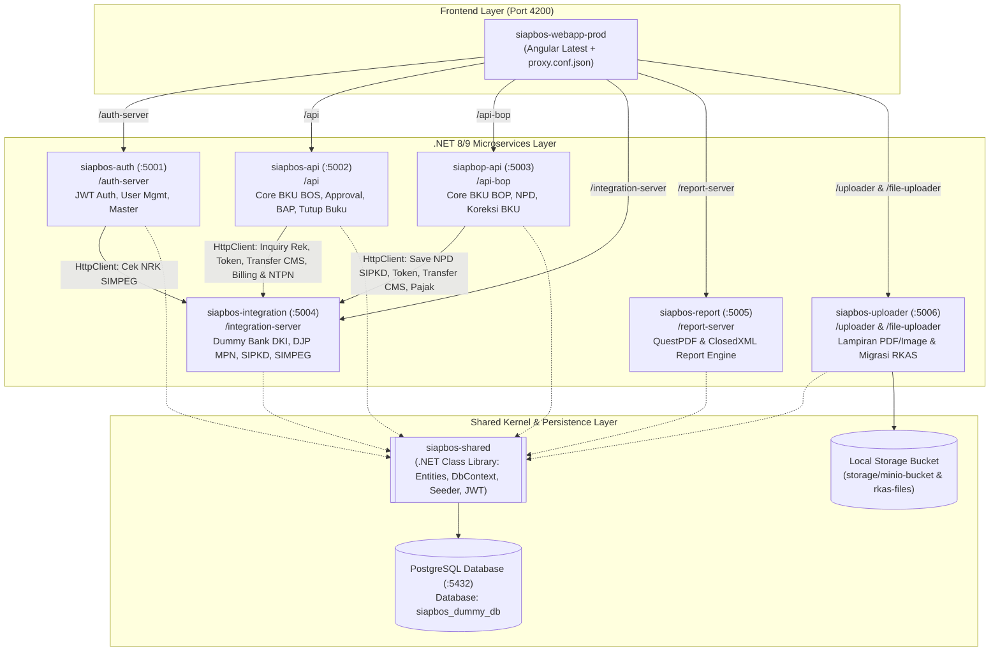

# Perencanaan Pembuatan Aplikasi SIAP BOS (Arsitektur Microservices - Technical Test Interview User)

Dokumen ini berisi cetak biru (*blueprint*) dan rencana implementasi *end-to-end* untuk membangun aplikasi **SIAP BOS (Sistem Informasi Akuntabilitas Pendidikan - BOSP & BOP)** versi *Technical Test Interview User* pada direktori kerja `D:\project_yosua\siap-bos-tes-user`.

Sesuai dengan arsitektur asli proyek **SIAP BOS (`D:\project_kerja_tdi\siap-bos`)**, aplikasi ini dibangun menggunakan **Arsitektur Microservices dengan Repositori/Folder Service Terpisah**, menggunakan stack teknologi:
- **Frontend**: **Angular (Versi Terbaru)** pada `siapbos-webapp-prod` dengan konfigurasi `proxy.conf.json` ke masing-masing microservice.
- **Backend Microservices**: **.NET (ASP.NET Core Web API)** yang dipecah menjadi 6 service independen (`siapbos-auth`, `siapbos-api`, `siapbop-api`, `siapbos-integration`, `siapbos-report`, `siapbos-uploader`) + 1 pustaka kontrak bersama (`siapbos-shared`).
- **Database**: **PostgreSQL** dengan skema terstruktur (`auth`, `siap`, `public`, `rkas`) dan *Auto-Seeder* otomatis.
- **Integrasi Eksternal**: **Dummy Integration Simulator** pada microservice `siapbos-integration` (Bank DKI Core/CMS, Pajak DJP MPN G3, SIPKD, dan SIMPEG).

---

## 1. Strategi Pemenuhan Kriteria Penilaian Interview User

Tiga indikator penilaian utama pada *technical test* ini dioptimalkan melalui strategi berikut:

| No | Kriteria Penilaian | Target & Strategi Implementasi pada Aplikasi |
| :- | :--- | :--- |
| 1 | **Berjalan (*Working End-to-End*)** | - **6 Microservices .NET + 1 Angular SPA berjalan serentak** dengan komunikasi *Inter-Service HTTP* (`siapbos-api` dan `siapbop-api` memanggil `siapbos-integration` melalui `HttpClient` persis seperti arsitektur produksi).<br/>- **Script Otomasi 1-Klik (`start-all.ps1` & `stop-all.ps1`)**: Menjalankan seluruh 6 microservice backend `.NET` dan frontend `Angular` sekaligus hanya dengan satu perintah PowerShell, lengkap dengan pengecekan *health-check* tiap port.<br/>- **Auto-Migration & Rich Data Seeder**: Saat `siapbos-auth` / `siapbos-api` dijalankan, database PostgreSQL otomatis terisi master sekolah (SMAN 1 Jakarta & SMPN 115 Jakarta), akun pengguna semua role (`ADMIN-DINAS`, `SUDIN`, `PA-NEGERI`, `TU-NEGERI`, `PK-NEGERI`), pagu RKAS, Dropping Dana, NPD BOP, dan contoh transaksi BKU di setiap tahapan status.<br/>- **Quick Role Switcher (Demo Toolbar)**: Memungkinkan perpindahan role (`Bendahara PK` $\rightarrow$ `Verifikator TU` $\rightarrow$ `Kepala Sekolah PA` $\rightarrow$ `Sudin` $\rightarrow$ `Admin Dinas`) secara instan dengan 1 klik saat *live demo* di hadapan pewawancara. |
| 2 | **Kerapian (*Clean Microservices & Code*)** | - **Pemisahan Folder Service Identik dengan Project Asli**: Setiap microservice memiliki tanggung jawab tunggal (*Single Responsibility*), port terpisah, dan Swagger UI masing-masing.<br/>- **Shared Domain & Database Contract (`siapbos-shared`)**: Menghindari duplikasi kode antar-microservice dengan menyatukan *Entities*, `SiapBosDbContext`, konfigurasi JWT, dan DTO kontrak integrasi.<br/>- **Frontend Angular Modern (Standalone + Signals)**: Kode frontend diorganisir berdasarkan modul bisnis (`bos-negeri`, `bop-negeri`, `administrator`, `user-management`, `sekolah`) dengan `proxy.conf.json` yang memetakan `/auth-server`, `/api`, `/api-bop`, `/integration-server`, `/report-server`, `/uploader`, dan `/file-uploader`. |
| 3 | **Layout (*UI/UX & Visual Fidelity*)** | - Mereplikasi identitas visual khas **SIAP BOSP-BOP DKI Jakarta** dengan tata letak modern, rapi, dan responsif (**Bootstrap 5 + Bootstrap Icons + SCSS Theme**):<br/>  1. **Split-Screen Login Page** dengan logo Jaya Raya & SIAP BOSP-BOP, *Show/Hide Password*, **Validasi Captcha Visual**, dan *Quick Demo Account Selector*.<br/>  2. **Landing Page Portal (`/landing-page`)** dengan *Card* pemilihan modul aplikasi sesuai hak akses role.<br/>  3. **Header Oranye Khas (`#FF9A00`)** dengan *Sidebar* navigasi dinamis, indikator Sekolah & Role aktif, serta tombol pindah modul.<br/>  4. **Filter Wilayah/Jenjang/Sekolah & Periode** serta **6 Summary Cards Saldo Real-Time** (*Pagu RKAS, Total Dropping Masuk, Total Belanja SPJ, Sisa Kas Bank, Pajak Terpungut, Pajak Disetor*).<br/>  5. **Status Badges** dan modal form interaktif untuk cek rekening Bank DKI, cek NPWP DJP, input potongan pajak, dan pratinjau PDF invoice. |

---

## 2. Peta Arsitektur Microservices (`.NET` + `Angular` + `PostgreSQL`)

Berikut adalah pemetaan 1-ke-1 antara repositori asli SIAP BOS dengan arsitektur Microservices `.NET` & `Angular` yang akan dibangun di `D:\project_yosua\siap-bos-tes-user`:

| No | Nama Folder / Repo | Port Lokal | Proxy Path di Angular | Tanggung Jawab Microservice (.NET Web API / Angular) |
| :- | :--- | :---: | :--- | :--- |
| 1 | `siapbos-auth` | `:5001` | `/auth-server` | **Auth & User Management Service**: Login OAuth2/JWT (`/oauth/token` & `/api/auth/*`), validasi Captcha, Quick Role Switcher, manajemen Pengguna (`trsiappengguna`), Otoritas (`trsiapotoritas`), Aplikasi (`trsiapaplikasi`), Menu (`trsiapmenu`), Master Periode, Master Sekolah, Master Pajak, serta sinkronisasi pegawai ke `siapbos-integration` (SIMPEG). |
| 2 | `siapbos-api` | `:5002` | `/api` | **Core BOS / BOSP Service**: Konfirmasi Saldo Rekening, Dropping Dana BOS (`tibosjodropping`), Konfirmasi Dana Masuk (`JO`), Konversi & Pengecekan RKAS, Input BKU & SPJ BOS (`tmbosbku` & `tmbosbkurinci`), Pengajuan PK (`Status 1`), Approval TU (`Status 2`), Approval PA (`Status 3`), Approval Sudin (`Status 4`), Permohonan Token, Pembayaran BKU CMS & Pajak MPN (via HTTP call ke `siapbos-integration`), Setoran STS, BAP Kas BOS, dan Tutup Buku BOS. |
| 3 | `siapbop-api` | `:5003` | `/api-bop` | **Core BOP & NPD Service**: Pengajuan **NPD (Nota Pencairan Dana) BOP**, Persetujuan NPD PA & Sudin (serta kirim ke SIPKD via `siapbos-integration`), Dropping Dana BOP, seluruh siklus BKU BOP (`tmsiapbop` & `tmsiapboprinci`), Pembayaran BKU & Pajak BOP, BAP Kas BOP, Tutup Buku BOP, serta modul **Koreksi BKU** (Koreksi Kode Akun, Koreksi Nilai Belanja, Batal Transfer SPJ). |
| 4 | `siapbos-integration` | `:5004` | `/integration-server` | **External Integration Gateway (Dummy Simulator)**:<br/>- **Bank DKI Simulator**: Inquiry Rekening (`inquiryCheckRek`, `inquiryOnUs`, `inquiryOffUs`), Generate Token OTP PA (`createToken`), Transfer SPJ BOS/BOP (`spj-transfer/transfer` $\rightarrow$ `bit39="00"` + Jurnal Bank), Inquiry/Payment **VA PLN** & **e-Order**, Mutasi Rekening Koran (`byNoRek` 12 transaksi & `inquiry-all-mutasi`).<br/>- **DJP / MPN G3 Simulator**: Inquiry NPWP 15/16 digit (`byNomorNpwp`, `inquiry-npwp-bos/bop`), Create Kode Billing 15 digit, Reset Billing, Inquiry Billing, Payment Pajak (**NTPN** & **NTB**).<br/>- **SIPKD Simulator**: Save NPD BOP (`/api/sipkd/npd/save`).<br/>- **SIMPEG Simulator**: Inquiry Pegawai ASN by NRK (`/api/simpeg/getPegawai/byNrk`). |
| 5 | `siapbos-report` | `:5005` | `/report-server` | **Report Generator Service (`QuestPDF` & `ClosedXML`)**:<br/>- **PDF Reports**: Form 22 (BKU BOS & BOP), Form 23 (Buku Bank), Form 25 (Buku Pajak gabungan & per `c_trx`), Kartu Kendali Kegiatan & Komponen, Form 19 BOP, Format K1–K7 (1A–1E), Dokumen SPJ, Bukti Penerimaan Negara (BPN Pajak), Surat Tanda Setoran (STS), Mutasi Rekening Koran, dan Berita Acara PLN.<br/>- **Excel Reports (`.xlsx`)**: Export BAP Kas, Laporan Monitoring Dinas (Tutup Buku, Serapan, Penyaluran, Realisasi, Aset), dan Laporan Monitoring Sudin (NPD, Realisasi, STS, Kertas Kerja). |
| 6 | `siapbos-uploader` | `:5006` | `/uploader` & `/file-uploader` | **File Object Storage & RKAS Migrator Service**:<br/>- Mengelola upload, preview PDF/Image, dan download lampiran Invoice SPJ & Berita Acara (`/api/v1/minio/upload`, `/preview`, `/download`, `/preview-pdf`).<br/>- Menangani upload file Excel/CSV RKAS dan eksekusi konversi pagu anggaran (`/api/file-uploader/upload/*` & `/execute-migration/:tahun`). |
| 7 | `siapbos-shared` | *(Library)* | - | **Shared Class Library (.NET)**: Berisi Entities PostgreSQL, `SiapBosDbContext`, `DbSeeder`, konstanta Role/Status, helper autentikasi JWT, dan kontrak HTTP Client antar-microservice. |
| 8 | `siapbos-webapp-prod` | `:4200` | *(Root Frontend)* | **Frontend Web Application (Angular Latest)**: Aplikasi SPA utama yang digunakan oleh Sekolah (`PK`, `TU`, `PA`), `SUDIN`, dan `ADMIN-DINAS`. |

### Diagram Arsitektur Microservices yang Akan Dibangun



---

## 3. Struktur Direktori Workspace (`D:\project_yosua\siap-bos-tes-user`)

Struktur folder pada `D:\project_yosua\siap-bos-tes-user` dibuat menyerupai struktur multi-repo `D:\project_kerja_tdi\siap-bos` dan diikat dengan satu file `.NET Solution` (`SiapBos.Microservices.sln`) serta script eksekusi otomatis:

```text
D:\project_yosua\siap-bos-tes-user\
├── ANALISIS_SIAP_BOS.md                  # Dokumen Hasil Analisis Sistem Eksisting
├── PERENCANAAN_PEMBUATAN_APLIKASI.md     # Dokumen Rencana Pembangunan Aplikasi (File ini)
├── README.md                             # Dokumentasi Arsitektur, Cara Menjalankan & Akun Demo
├── SiapBos.Microservices.sln             # Solution .NET pengikat seluruh microservice backend
├── start-all.ps1                         # Script 1-Klik menjalankan semua 6 Backend + Angular
├── stop-all.ps1                          # Script 1-Klik menghentikan seluruh proses service
│
├── siapbos-shared\                       # Class Library Bersama (.NET)
│   ├── Entities\                         # Model Tabel PostgreSQL (User, Sekolah, Rkas, BkuBos, BkuBop, Pajak, BapKas, Mutasi)
│   ├── Data\
│   │   ├── SiapBosDbContext.cs           # EF Core DbContext PostgreSQL
│   │   └── DbSeeder.cs                   # Auto-Seeder Master Data, RKAS, Dropping, NPD & Transaksi BKU
│   ├── DTOs\                             # Kontrak Request/Response Antar-Microservice
│   └── Security\                         # JwtTokenHelper & Auth Extensions
│
├── siapbos-auth\                         # Microservice 1: Auth & User Management (:5001)
│   ├── Controllers\
│   │   ├── OAuthController.cs            # POST /oauth/token, Captcha, Switch-Role, Profile
│   │   ├── PenggunaController.cs         # CRUD Pengguna, Otoritas, Aplikasi, Menu
│   │   └── MasterController.cs           # Master Sekolah, Tahun Anggaran, Periode, Pajak, BAS
│   ├── Program.cs
│   └── appsettings.json
│
├── siapbos-api\                          # Microservice 2: Core BKU BOS/BOSP (:5002)
│   ├── Controllers\
│   │   ├── KonfirmasiDanaController.cs   # Konfirmasi Saldo Rekening & Konfirmasi Dropping BOS
│   │   ├── RkasBosController.cs          # Pengecekan Data RKAS & Ringkasan Pagu BOS
│   │   ├── InputSpjBosController.cs      # CRUD BKU BOS (JJ, JG, LL, ST) & Rincian Pajak (P1..P7)
│   │   ├── WorkflowBosController.cs      # Pengajuan PK, Approval TU, Approval PA, Approval Sudin
│   │   ├── PembayaranBosController.cs    # Permohonan Token, Transfer SPJ CMS, Bayar Pajak MPN
│   │   └── PenutupanBosController.cs     # Setoran STS, BAP Kas BOS, Tutup Buku & Batal Tutup BKU
│   ├── Program.cs
│   └── appsettings.json
│
├── siapbop-api\                          # Microservice 3: Core BKU BOP & NPD (:5003)
│   ├── Controllers\
│   │   ├── NpdBopController.cs           # Input NPD, Pengajuan NPD, Approval NPD PA & Sudin (SIPKD)
│   │   ├── InputSpjBopController.cs      # CRUD BKU BOP & Rincian Pajak BOP
│   │   ├── WorkflowBopController.cs      # Pengajuan PK, Approval TU/PA/Sudin BOP
│   │   ├── PembayaranBopController.cs    # Token, Transfer SPJ BOP, Bayar Pajak BOP
│   │   ├── KoreksiBkuBopController.cs    # Koreksi Kode Akun, Koreksi Nilai Belanja, Batal Transfer SPJ
│   │   └── PenutupanBopController.cs     # Setoran STS BOP, BAP Kas BOP, Tutup Buku BOP
│   ├── Program.cs
│   └── appsettings.json
│
├── siapbos-integration\                  # Microservice 4: Dummy Integration Gateway (:5004)
│   ├── Controllers\
│   │   ├── BankDkiController.cs          # Inquiry Rekening, Create Token, VA PLN, e-Order
│   │   ├── SpjTransferController.cs      # Transfer SPJ BOS & BOP (Overbooking & SKN, bit39="00")
│   │   ├── MutasiController.cs           # Mutasi 12 Transaksi Terakhir & Inquiry Semua Mutasi
│   │   ├── NpwpController.cs             # Validasi NPWP 15/16 Digit
│   │   ├── PajakSpjTransferController.cs # Create Kode Billing, Reset, Inquiry, Payment (NTPN & NTB)
│   │   ├── SaveNpdBopSipkdController.cs  # Simulator Kirim NPD BOP ke SIPKD
│   │   └── SimpegIntegrasiController.cs  # Simulator Cek Pegawai ASN by NRK
│   ├── Program.cs
│   └── appsettings.json
│
├── siapbos-report\                       # Microservice 5: PDF & Excel Report Server (:5005)
│   ├── Controllers\
│   │   ├── FormReportBosController.cs    # PDF Form 22, Form 23, Form 25, Kartu Kendali BOS
│   │   ├── FormReportBopController.cs    # PDF Form 22, 23, 25, Form 19, Format K1-K7 (1A-1E) BOP
│   │   ├── DokumenSpjPajakController.cs  # PDF SPJ, BPN Pajak, STS, Mutasi Rekening, BA PLN
│   │   └── MonitoringExcelController.cs  # Excel BAP Kas, Monitoring Dinas & Monitoring Sudin
│   ├── Services\
│   │   ├── BosBopPdfGenerator.cs         # Engine QuestPDF
│   │   └── BosBopExcelGenerator.cs       # Engine ClosedXML
│   ├── Program.cs
│   └── appsettings.json
│
├── siapbos-uploader\                     # Microservice 6: MinIO Dummy Uploader & RKAS Migrator (:5006)
│   ├── Controllers\
│   │   ├── MinioController.cs            # Upload, Preview PDF/Image & Download Bukti SPJ
│   │   └── RkasFileUploaderController.cs # Upload Excel/CSV RKAS & Execute Migration ke Database
│   ├── Storage\                          # Folder penyimpanan lokal pengganti bucket MinIO
│   ├── Program.cs
│   └── appsettings.json
│
└── siapbos-webapp-prod\                  # Aplikasi Frontend Angular Versi Terbaru (:4200)
    ├── proxy.conf.json                   # Reverse Proxy ke :5001, :5002, :5003, :5004, :5005, :5006
    ├── src\
    │   ├── app\
    │   │   ├── core\                     # Guards, JWT Interceptor, Services, Models
    │   │   ├── shared\                   # SekolahListFilter, SaldoCards, Captcha, RoleSwitcher, StatusBadge
    │   │   ├── containers\
    │   │   │   └── default-layout\       # Header Oranye #FF9A00, Sidebar Dinamis per Modul, Footer
    │   │   └── pages\
    │   │       ├── login\                # Split-Screen Login + Captcha + Quick Demo Login
    │   │       ├── landing-page\         # Portal Pilihan Modul (BOS, BOP, Admin, User Mgmt, Sekolah)
    │   │       ├── bos-negeri\           # Seluruh Menu Transaksi & Laporan BKU BOS Negeri
    │   │       ├── bop-negeri\           # Seluruh Menu NPD, Transaksi, Koreksi & Laporan BKU BOP
    │   │       ├── administrator\        # Dropping Dana BOS/BOP, Konversi/Cek RKAS, Batas Pengajuan
    │   │       ├── user-management\      # Pengguna, Otoritas, Aplikasi, Menu, Periode, Sekolah, Pajak
    │   │       └── sekolah\              # Konfirmasi Saldo Rekening & Validasi Rekening/NPWP Sekolah
    │   └── styles.scss
    └── angular.json
```

---

## 4. Konfigurasi Proxy Frontend (`siapbos-webapp-prod/proxy.conf.json`)

Agar kode Angular memanggil path endpoint yang **sama persis** dengan aplikasi SIAP BOS asli, file `proxy.conf.json` pada `siapbos-webapp-prod` dikonfigurasi sebagai berikut:

```json
{
  "/auth-server": {
    "target": "http://localhost:5001",
    "secure": false,
    "changeOrigin": true,
    "pathRewrite": { "^/auth-server": "" }
  },
  "/api": {
    "target": "http://localhost:5002",
    "secure": false,
    "changeOrigin": true
  },
  "/api-bop": {
    "target": "http://localhost:5003",
    "secure": false,
    "changeOrigin": true
  },
  "/integration-server": {
    "target": "http://localhost:5004",
    "secure": false,
    "changeOrigin": true,
    "pathRewrite": { "^/integration-server": "" }
  },
  "/report-server": {
    "target": "http://localhost:5005",
    "secure": false,
    "changeOrigin": true,
    "pathRewrite": { "^/report-server": "" }
  },
  "/uploader": {
    "target": "http://localhost:5006",
    "secure": false,
    "changeOrigin": true,
    "pathRewrite": { "^/uploader": "" }
  },
  "/file-uploader": {
    "target": "http://localhost:5006",
    "secure": false,
    "changeOrigin": true,
    "pathRewrite": { "^/file-uploader": "" }
  }
}
```

---

## 5. Rancangan Skema Database PostgreSQL (`siapbos_dummy_db`)

Seluruh microservice terhubung ke database PostgreSQL **`siapbos_dummy_db`** melalui pustaka `siapbos-shared`. Tabel-tabel dirancang merepresentasikan domain asli SIAP BOS:

1. **Kelompok Tabel Auth & Master (`siapbos-auth`)**:
   - `AppUsers` (`trsiappengguna`): Menyimpan data pengguna, NRK, NIP, Username, PasswordHash, `RoleCode` (`ADMIN-DINAS`, `SUDIN`, `PA-NEGERI`, `TU-NEGERI`, `PK-NEGERI`), `SekolahId`, `WilayahSudin`.
   - `AppRoles` (`trsiapotoritas`) & `AppModules` (`trsiapaplikasi`: `BOS`, `BOP`, `ADMN`, `UM`, `LAIN`).
   - `Sekolah` (`trsiapsekolah`): NPSN, Nama Sekolah, Jenjang (`SD`, `SMP`, `SMA`, `SMK`, `SLB`), Wilayah Sudin, Rekening Bank DKI BOS & BOP, Saldo Kas BOS & BOP, NPWP Sekolah, Nama/NIP/NRK Kepala Sekolah (PA), Kasubag TU, dan Bendahara (PK), serta status konfirmasi rekening.
   - `MasterPeriode` (`trperiode` & `trtahunangg`): Tahun anggaran, jenis periode, tahap/bulan, dan batas tanggal pengajuan belanja.
   - `BasAccounts` (`trbas`): Kode Akun Standar (`5.1.02.xx`), Nama Akun, Kelompok Belanja, flag BOS & BOP.
2. **Kelompok Tabel Anggaran RKAS, Dropping Dana & NPD (`siapbos-api` & `siapbop-api`)**:
   - `RkasItems`: Pagu anggaran per Sekolah, Sumber Dana (`BOS`/`BOP`), Periode, Standar Nasional Pendidikan (SNP), Kode/Nama Kegiatan, Kode Akun BAS, Kode/Nama Komponen, Spesifikasi, Volume, Satuan, Harga Satuan, Total Pagu, dan Total Realisasi.
   - `DroppingDanas` (`tibosjodropping` & `tibopjodropping`): Data penyaluran dana per tahap/periode beserta status konfirmasi masuk ke BKU (`IsConfirmedToBku`).
   - `NpdBops`: Pengajuan Nota Pencairan Dana BOP dari Sekolah $\rightarrow$ Persetujuan PA $\rightarrow$ Persetujuan Sudin $\rightarrow$ Nomor Registrasi SIPKD.
3. **Kelompok Tabel Transaksi BKU, Rincian, Pajak, Koreksi & BAP Kas**:
   - `BkuTransactions` (mencakup BKU BOS & BOP dengan pembeda `SumberDana = "BOS" | "BOP"`):
     - Header BKU: `NomorBku`, `NomorBukti`, `TanggalTransaksi`, `KodeTrx` (`JO`, `JJ`, `JG`, `LL`, `ST`), `JenisPembayaran` (`TRANSFER`, `VA_PLN`, `E_ORDER`), `Uraian`.
     - Nilai: `NilaiBrutoMasuk`, `NilaiBrutoKeluar`, `TotalPotonganPajak`, `NilaiNettoTransfer`.
     - Rekanan: `NamaRekanan`, `KodeBankRekanan`, `NamaBankRekanan`, `NoRekRekanan`, `NamaPemilikRek`, `NpwpRekanan`, `NamaWpRekanan`, `NoVaAtauPesanan`, `FileLampiranPath`.
     - Workflow Status (`StatusBku`):
       - `0` = Draft / Belum Diajukan
       - `1` = Diajukan ke Verifikator (TU)
       - `2` = Disetujui TU / Diajukan ke Kepala Sekolah (PA)
       - `3` = Disetujui PA (Siap Token & Transfer)
       - `4` = Disetujui Sudin
       - `5` = Lunas Transfer CMS Bank DKI (`bit39 = "00"`)
       - `9` = Ditolak / Dikembalikan
     - Otorisasi CMS Bank DKI: `TokenOtpPa`, `TokenExpiredAt`, `NoJurnalBank`, `TanggalTransferBank`, `StatusTransferBank`.
     - Status Periode: `IsTutupBuku`, `TanggalTutupBuku`.
   - `BkuDetailItems` (`tmbosbkurinci` / `tmsiapboprinci`): Rincian item komponen RKAS yang dibelanjakan pada BKU.
   - `BkuTaxItems` (`P1` PPh 21, `P2` PPh 22, `P3` PPh 23, `P4` PPh 4 Ayat 2, `P5` PPN): Menyimpan `KodeMap`, `KodeJenisSetoran`, `MasaPajak`, `NilaiPajak`, **`KodeBilling` (15 digit)**, `BillingExpiredAt`, **`Ntpn` (16 karakter)**, **`Ntb` (12 digit)**, `TanggalLunasPajak`, dan `StatusPajak` (`0`=Belum Billing, `1`=Billing Aktif, `2`=Lunas BPN).
   - `BkuCorrections`: Riwayat pengajuan & persetujuan Koreksi Kode Akun, Koreksi Nilai Belanja, dan Batal Transfer SPJ.
   - `BankMutations`: Catatan mutasi rekening koran Bank DKI sekolah (Debet/Kredit/Saldo Berjalan) yang otomatis bertambah saat ada Dropping Dana, Jasa Giro, Transfer SPJ, Setoran Pajak MPN, atau Setoran STS.
   - `BapKasReports`: Berita Acara Pemeriksaan Kas per periode (Saldo BKU vs Saldo Rekening Koran vs Kas Tunai, Selisih Kas, serta status persetujuan PA dan Sudin/Dinas).

---

## 6. Spesifikasi Detail Simulator Integrasi Dummy (`siapbos-integration` - Port 5004)

Microservice `siapbos-integration` menyimulasikan seluruh perilaku sistem eksternal Pemprov DKI Jakarta, Bank DKI, dan DJP Pajak secara realistis:

1. **Bank DKI — Inquiry Rekening (`/api/bank-dki/inquiryCheckRek`, `inquiryOnUs`, `inquiryOffUs`)**:
   - Memvalidasi nomor rekening tujuan dan kode bank (`111` untuk Bank DKI, `014` BCA, `002` BRI, `008` Mandiri, `009` BNI).
   - Mengembalikan nama pemilik rekening terverifikasi, status rekening `"AKTIF"`, dan kode respon `"00"`.
2. **Bank DKI — Inquiry VA PLN & e-Order (`/api/bank-dki/va/biller-inquiry-bos`, `/api/bank-dki/biller-inquiry`)**:
   - Jika diberikan ID Pelanggan PLN atau Nomor Pesanan e-Order DKI (contoh `EORD-2026-001`), mengembalikan rincian tagihan, nama toko/merchant, dan nominal tagihan secara otomatis untuk mengisi form BKU.
3. **Bank DKI — Generate Token OTP Kepala Sekolah (`/api/bank-dki/createToken`)**:
   - Menerima 6 digit `nrk` Kepala Sekolah (`PA-NEGERI`), memvalidasi keaktifan pejabat, dan menerbitkan **6 digit kode Token OTP** yang berlaku selama 30 menit.
4. **Bank DKI — Eksekusi Transfer SPJ CMS (`/api/spj-transfer/transfer` & `transfer-bop`)**:
   - Memeriksa kecocokan Token OTP dan kecukupan saldo rekening sekolah.
   - Mendebet saldo rekening sekolah (BOS/BOP) sebesar **Nilai Netto SPJ**, menerbitkan **Nomor Jurnal Bank DKI (`JRN-DKI-2026xxxxxx`)**, mencatat transaksi ke tabel `BankMutations`, dan mengembalikan respon sukses `bit39 = "00"`.
5. **Bank DKI — Mutasi Rekening Koran (`/api/mutasi/byNoRek` & `inquiry-all-mutasi`)**:
   - Mengembalikan daftar 12 mutasi terakhir atau mutasi per rentang tanggal dari tabel `BankMutations`.
6. **DJP / MPN G3 — Validasi NPWP (`/api/npwp/byNomorNpwp`, `inquiry-npwp-bos`, `inquiry-npwp-bop`)**:
   - Memvalidasi NPWP 15/16 digit dan mengembalikan Nama Wajib Pajak, Alamat KPP Jakarta, serta status `"AKTIF / PKP"`.
7. **DJP / MPN G3 — Siklus Billing & Pembayaran Pajak (`/api/spj-transfer-pajak/{id}/create`, `reset`, `inquiry`, `payment`, `cekStatus`)**:
   - `create`: Menghasilkan **15 digit Kode Billing DJP** (`82026...`) dan masa aktif 30 hari.
   - `reset`: Mereset Kode Billing agar dapat diterbitkan ulang.
   - `inquiry`: Mengembalikan detail tagihan pajak pada server MPN.
   - `payment`: Mendebet saldo pajak di rekening sekolah, menerbitkan **16 karakter NTPN** (contoh `NTPN2026DKI84920`) dan **12 digit NTB**, mencatat mutasi bank, dan menandai pajak **Lunas BPN**.
8. **SIPKD — Kirim NPD BOP (`/api/sipkd/npd/save`)**:
   - Menerima data NPD BOP yang telah disetujui Sudin, menerbitkan nomor dokumen SIPKD (`SIPKD/NPD-BOP/2026/xxxx`), dan mencairkan dana ke saldo kas BOP sekolah.
9. **SIMPEG — Inquiry Pegawai ASN (`/api/simpeg/getPegawai/byNrk`)**:
   - Mengembalikan data ASN (Nama Lengkap, NIP, NIK, Jabatan, Golongan, Unit Kerja) berdasarkan 6 digit NRK.

---

## 7. Spesifikasi Detail Generator Report (`siapbos-report` - Port 5005)

Microservice `siapbos-report` menghasilkan file **PDF** (menggunakan `QuestPDF`) dan **Excel `.xlsx`** (menggunakan `ClosedXML`) yang dapat langsung diunduh dari halaman laporan Angular:

1. **Laporan PDF (Standar Regulasi BOS & BOP)**:
   - **Formulir 22 (`Form22_Bos.pdf` & `Form22_Bop.pdf`)**: Buku Kas Umum (BKU) lengkap dengan kop Dinas Pendidikan DKI Jakarta, identitas sekolah, tabel kronologis Debet/Kredit/Saldo, rincian kas bank & tunai, serta tanda tangan Kepala Sekolah (PA) & Bendahara (PK).
   - **Formulir 23 (`Form23_Bos.pdf` & `Form23_Bop.pdf`)**: Buku Pembantu Bank.
   - **Formulir 25 (`Form25_Bos.pdf` & `Form25_Bop.pdf`)**: Buku Pembantu Pajak (gabungan seluruh pajak maupun difilter per jenis pajak `P1`–`P7`).
   - **Kartu Kendali Kegiatan & Komponen (`Kartu_Kendali.pdf`)**: Perbandingan Pagu RKAS vs Realisasi vs Sisa Anggaran per kegiatan dan komponen belanja.
   - **Formulir 19 & Format K1–K7 / 1A–1E (`Form19_Bop.pdf`, `Format_1A_1E.pdf`)**: Laporan pertanggungjawaban realisasi dana per komponen dan rekapitulasi penggunaan dana tahunan/tahap.
   - **Surat Pertanggungjawaban / Bukti Pengeluaran Kas (`SPJ_BKU.pdf`)**: Kwitansi & rincian SPJ per transaksi BKU lengkap dengan potongan pajak dan nomor jurnal transfer Bank DKI.
   - **Cetakan Bukti Penerimaan Negara (`BPN_Pajak.pdf`)**: Dokumen bukti lunas setoran pajak resmi yang memuat Kode Billing, **NTPN**, **NTB**, NPWP, dan Kode MAP.
   - **Surat Tanda Setoran (`STS.pdf`)**: Bukti setoran pengembalian sisa kas / jasa giro.
   - **Cetakan Mutasi Rekening Koran (`Mutasi_Rekening.pdf`)** & **Berita Acara Pembayaran PLN (`BA_PLN.pdf`)**.
2. **Laporan Excel (`.xlsx`)**:
   - **Export Excel BAP Kas (`BAP_Kas.xlsx`)**: Berita Acara Pemeriksaan Kas sekolah.
   - **Export Excel Monitoring Dinas & Sudin (`Monitoring_Dinas_Sudin.xlsx`)**: Multi-sheet Excel berisi Rekap Penyaluran/Dropping, Realisasi Serapan per Sekolah, Status Pembayaran Pajak, Monitoring NPD BOP, dan Status Tutup Buku.

---

## 8. Tahapan Eksekusi Pembangunan Aplikasi (Step-by-Step Roadmap)

1. **Tahap 1 — Pembuatan Solution & `siapbos-shared` + Database PostgreSQL**:
   - Membuat `SiapBos.Microservices.sln` dan project class library `siapbos-shared`.
   - Membangun seluruh *Entities*, `SiapBosDbContext`, helper JWT, dan `DbSeeder` (data lengkap SMAN 1 Jakarta, SMPN 115 Jakarta, akun semua role, RKAS, Dropping Dana, NPD BOP, dan transaksi BKU BOS/BOP).
2. **Tahap 2 — Pembangunan 6 Microservices Backend `.NET` (`:5001` s/d `:5006`)**:
   - Membangun `siapbos-auth` (`:5001`) untuk autentikasi, manajemen user/role/menu, dan master data.
   - Membangun `siapbos-integration` (`:5004`) untuk simulator Bank DKI, Pajak DJP MPN, SIPKD, dan SIMPEG.
   - Membangun `siapbos-api` (`:5002`) untuk seluruh siklus transaksi BKU BOS/BOSP.
   - Membangun `siapbop-api` (`:5003`) untuk siklus NPD BOP, transaksi BKU BOP, dan Koreksi BKU.
   - Membangun `siapbos-report` (`:5005`) dengan `QuestPDF` dan `ClosedXML` untuk seluruh cetakan PDF dan Excel.
   - Membangun `siapbos-uploader` (`:5006`) untuk upload/preview bukti PDF invoice dan migrasi RKAS.
3. **Tahap 3 — Pembangunan Frontend Angular Terbaru (`siapbos-webapp-prod` - `:4200`)**:
   - Menginisialisasi proyek Angular terbaru dengan `proxy.conf.json`, Bootstrap 5, dan tema warna khas SIAP BOS (`#FF9A00`).
   - Membangun halaman **Login (+Captcha & Quick Demo Login)**, **Landing Page Portal Modul**, **Default Layout (Header Oranye + Sidebar Dinamis + Quick Role Switcher)**, dan **Filter Sekolah**.
   - Membangun seluruh halaman fitur: **Konfirmasi Saldo Rekening**, **Konfirmasi Dropping Dana & NPD BOP**, **Input BKU/SPJ & Pajak**, **Pengajuan & Persetujuan Berjenjang (PK/TU/PA/Sudin)**, **Permohonan Token & Pembayaran CMS Bank DKI**, **Pembayaran Pajak MPN (Kode Billing & NTPN)**, **Setoran STS & Koreksi BKU**, **Mutasi Rekening Koran, BAP Kas & Tutup Buku**, **Pusat Laporan PDF/Excel**, **Administrator Dinas**, dan **User Management**.
4. **Tahap 4 — Pembuatan Script Otomasi (`start-all.ps1` & `stop-all.ps1`) dan Pengujian End-to-End**:
   - Menyusun script PowerShell untuk menjalankan ke-6 microservice `.NET` dan `Angular` sekaligus, menguji seluruh alur bisnis dan unduhan report PDF/Excel, serta menyusun dokumentasi lengkap pada `README.md`.


---

## 9. Rencana Pengembangan Bertahap (*Incremental Phase-by-Phase Roadmap*)

Agar pengembangan maupun penyempurnaan aplikasi dapat dikerjakan **secara terstruktur, perlahan-lahan, satu modul per satu modul** dengan risiko minim, berikut adalah peta jalan (*roadmap*) bertahap beserta kriteria selesai (*Definition of Done*) dan pengujiannya:

| Fase | Fokus Modul / Increment | Target Deliverables | Cara Verifikasi & Testing |
| :--- | :--- | :--- | :--- |
| **Fase 0** | **Fondasi & Kontrak Microservices (`siapbos-shared`)** | Solution `.NET`, entity PostgreSQL (`auth`, `public`, `siap`, `rkas`), JWT authentication extensions, serta `DbSeeder` otomatis. | Build solution `0 Error`, koneksi PostgreSQL aktif, skema & data awal ter-seed otomatis saat `siapbos-auth` start. |
| **Fase 1** | **Portal Publik & Auth Modern (`siapbos-auth` + Frontend Shell)** | Endpoint publik `/api/public/tahun-anggaran`, `/api/public/landing-summary`, Captcha & JWT Login, Quick Role Switcher, Fix Ganti vs Reset Password OTP, **Redesain Landing Portal (Berita, Regulasi, SOP)** & **Sidebar-Topbar Indigo-Amber Layout** + sistem animasi dasar. | Uji HTTP `200` publik & login tiap role, klik seluruh menu Landing Publik bebas 404, cek modal reset sandi. |
| **Fase 2** | **Master Data, SIMPEG & Migrasi RKAS (`:5001`, `:5002`, `:5006`)** | Manajemen Pengguna + Inquiry SIMPEG (`byNrk`), Master Sekolah & Konfirmasi Rekening Bank DKI/NPWP, Download & Upload Excel RKAS, serta Admin Dropping Dana (`JO`). | Uji inquiry SIMPEG, konfirmasi rekening menyimpan flag `isRekeningConfirmed`, upload Excel RKAS menambah record di database. |
| **Fase 3** | **Core BKU BOSP & Persetujuan Berjenjang (`siapbos-api :5002`)** | Konfirmasi Dropping (`JO`), Input SPJ (`JJ`) dengan detail RKAS, potongan pajak `P1–P5`, lampiran PDF MinIO uploader, serta Approval berjenjang **PK (0→1) → TU (1→2) → PA (2→3) → Sudin (4)** + alur penolakan/hapus draft. | Uji pembuatan BKU dari Draft hingga status disetujui PA, uji validasi pagu RKAS & alur penolakan `Status=9`. |
| **Fase 4** | **Integrasi Cashless Bank DKI CMS & Pajak MPN (`:5004`)** | Permohonan Token OTP PA, eksekusi Transfer CMS (Overbooking/SKN/VA PLN/e-Order) mengurangi saldo & membentuk mutasi debet, serta siklus pajak MPN (**Create Billing → Reset → Inquiry → Payment NTPN/NTB**) & Audit Log `tiintegration_log`. | Pastikan saldo berkurang tepat sebesar Netto, muncul `NoJurnalBank` + baris mutasi debet, serta status pajak menjadi Lunas dengan NTPN. |
| **Fase 5** | **Fitur Khusus BOP APBD & SIPKD (`siapbop-api :5003`)** | Alur **NPD BOP**: Draft → Ajukan PA → Approval PA → Approval Sudin → auto-save ke **SIPKD** & auto-terbit Dropping BOP; plus modul **Koreksi BKU** (`KODE_AKUN` dan `BATAL_TRANSFER`). | Pastikan approval Sudin pada NPD menghasilkan `NomorSipkd` & dropping BOP baru; uji `BATAL_TRANSFER` mengembalikan saldo BOP & mereset status ke Draft. |
| **Fase 6** | **Rekonsiliasi, BAP Kas, Tutup Buku & Reporting (`siapbos-report :5005`)** | Cek mutasi Bank DKI, hitung pecahan kas tunai BAP Kas, Approval PA/Dinas, Tutup Buku & Buka Buku, Setoran STS, serta cetak **PDF (`Form 22`, `23`, `25`, `Kartu Kendali`, `Form 19 K1–K7`, `SPJ`, `BPN`, `STS`, `Mutasi`)** & **Excel (`BAP Kas`, `Monitoring`)**. | Cek seluruh endpoint PDF mengembalikan header biner `%PDF` dan seluruh Excel mengembalikan header `PK` tanpa exception. |
| **Fase 7** | **Polishing UX Motion, Uji Integrasi Otomatis & Browser QA** | Pengayaan animasi profesional (*staggered bento cards*, *animated SVG serapan donut*, *stepper timeline*, *shimmer*), eksekusi `test-e2e.ps1` end-to-end, dan inspeksi visual browser bebas error konsol/jaringan. | `test-e2e.ps1` 100% PASS, `dotnet build` & `ng build` 0 error, serta verifikasi browser menampilkan semua halaman bersih & responsif. |

---

## 10. Spesifikasi Redesain UI/UX & Sistem Animasi Profesional

Untuk memberikan tampilan yang **jauh lebih modern, profesional, nyaman di mata (*ergonomic*), dan berbeda dari desain klasik CoreUI `#ff9800`**:
1. **Palet Warna Baru (*Jakarta GovTech Executive*)**:
   - **Latar Aplikasi**: `#F4F6FB` (*Cool Alabaster Slate*), kartu permukaan `#FFFFFF` dengan hairline border `rgba(15, 23, 42, 0.08)` dan bayangan berlapis halus.
   - **Sidebar Navigasi & Hero Aksen**: *Midnight Jakarta Navy* (`#0B132B` → `#16213E`) yang kontras, modern, dan memfokuskan perhatian pada data transaksi.
   - **Identitas Aksen SIAP**: *Amber Gold to Warm Orange* (`#F59E0B` → `#EA580C`) sebagai garis aksen, status aktif, CTA utama, dan logo brand sehingga benang merah **SIAP BOSP BOP DKI Jakarta** tetap kental namun jauh lebih elegan.
2. **Hierarki Layout Modern**:
   - **Portal Publik Terpadu (`/landingpage`)**: Dapat diakses sebelum login sebagai pusat informasi resmi (Berita Penyaluran, Regulasi Juknis, Prosedur 6 Langkah, Anggaran Transparan Real-Time dari DB) dan otomatis berubah menjadi **Bento Module Hub** ketika pengguna sudah masuk.
   - **Split Workspace Shell**: Topbar kaca (*glassmorphism*) putih dengan *breadcrumb*, indikator live microservices, & *Quick Role Switcher*, bersanding dengan *collapsible Navy Sidebar*.
   - **Dashboard Analitik Visual**: Dilengkapi *Animated SVG Progress Ring* untuk persentase serapan pagu RKAS, grafik batang arus kas bulanan beranimasi, serta *Pipeline Stepper* interaktif.
3. **Arsitektur Animasi & Micro-Interactions (`styles.scss`)**:
   - *Page Entrance (`pageReveal`)* & *Staggered Reveal (`--stagger`)* menggunakan akselerasi GPU (`transform` + `opacity`) dengan kurva *spring* `cubic-bezier(0.22, 1, 0.36, 1)`.
   - *Modal Pop Spring (`modalPop`)*, *Toast Slide-In*, *Floating Hero Cards*, serta dukungan aksesibilitas `@media (prefers-reduced-motion: reduce)`.

---

## 8. Pembaruan Desain `#FF9A00`, 5 Menu Utama, & Konsolidasi 3 Schema (`auth`, `oauth`, `siap`)

1. **Konsolidasi Schema PostgreSQL (`auth`, `oauth`, `siap`)**:
   - Seluruh entitas EF Core dipetakan secara eksplisit ke dalam 3 schema (`auth`, `oauth`, `siap`) dengan `modelBuilder.HasDefaultSchema("siap")` tanpa menggunakan schema `public` maupun `rkas`.
   - Setiap proses login mencatat token aktif ke `oauth.access_token` dan jejak histori ke `oauth.history_access_token`.
2. **Akun Referensi `ADMIN-TDI` & Tahun Anggaran `2025` / `2026`**:
   - Mendukung login menggunakan `Tahun = 2025`, `ID Login = ADMIN-TDI`, `Password = MonaS123!` (maupun 1-klik tombol demo), dengan data transaksi lengkap baik pada Tahun Anggaran `2025` maupun `2026`.
3. **5 Menu Utama & 74 Sub-Menu Aktif**:
   - Menampilkan **5 Menu Utama** (`User Management`, `BKU BOSP Negeri`, `BKU BOP Negeri`, `Administrator`, `Help Desk`) beserta seluruh sub-menunya baik pada Mega-Menu/Kartu Landing Page, Topbar `#FF9A00`, maupun Sidebar Workspace.
4. **Tampilan Kreatif `#FF9A00` & Logo SIAP BOS Jelas**:
   - Menggunakan palet `#FF9A00`, menampilkan `assets/img/login/Logo.png` secara jelas pada emblem kontras tinggi, serta menyajikan `/landingpage` yang ringkas, kreatif, dan minim teks penjelasan panjang.
